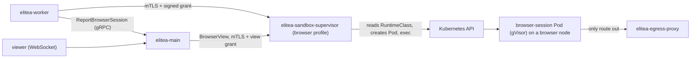

The cloud browser gives an agent that runs on the platform a real browser: it navigates, reads and acts on pages, and a user can watch it live and take over. Each browser is its own *browser session*, a Pod in the execution namespace that the sandbox supervisor creates on the run's first browser call. A session renders untrusted pages, so it runs under gVisor on a dedicated node pool, and its only route out is the egress proxy.

This page assumes the [cloud executor](/deployment/cloud-executor-kubernetes) pieces it shares are in place: the sandbox runtime, the execution namespace, the supervisor and its material Secret, and the egress proxy. It adds:

| Piece | Comes from |
|---|---|
| A browser node pool with the gVisor RuntimeClass | your platform (GKE Sandbox), or the `elitea-sandbox-runtime` installer (`sandboxRuntime`) |
| The supervisor's `browser` profile, its Service and port | the `elitea` chart (`sandboxKubernetes.browserSessions`) |
| The session Pods' egress policy (proxy only) | the `elitea` chart |
| The browser server certificate | **you** (one command below) |



## What the supervisor enforces

| Rule | Value |
|---|---|
| Ceiling, `full` engine | 2 CPUs, 2 GiB |
| Ceiling, `lite` engine | 1 CPU, 512 MiB. Off until the engine bake-off admits it |
| Wall limit per session | 60 minutes (`maxWallSeconds`) |
| Pages per session | 3 (`maxPages`) |
| Sessions per run | 3 (`sessionsPerRun`) |
| Sessions at once | `concurrency` (default 100). A start at the limit waits up to 30 s, then fails `browser_capacity` |
| End of a session | run end plus a 10-minute linger (so a user can still watch the last page), 15 minutes idle, or the wall limit, whichever comes first |
| Reuse | never. A destroyed session's name is refused for 24 hours |
| `--no-sandbox` | only on gVisor. With `engineSandbox: false` the supervisor refuses every start unless the RuntimeClass handler is `runsc` or `gvisor`. On Kata, set `engineSandbox: true` |

A session Pod has no service-account token, no DNS (the proxy resolves names), a read-only root, memory-backed `/tmp` and `/dev/shm`, and an `activeDeadlineSeconds` backstop of the wall plus the linger plus 2 minutes, so it is gone even if the supervisor is not. The supervisor sweeps every 15 seconds and removes session Pods it does not know, for example after a restart.

## Step 1: the browser node pool

Plan about 1 to 2 GiB per concurrent `full` session; ADR-0049 plans for 10% of concurrent agents. Label and taint the pool so nothing else lands there:

```bash
kubectl label node <browser-node> elitea.ai/browser=true
kubectl taint node <browser-node> elitea.ai/browser=true:NoSchedule
```

On GKE, create the pool with `--sandbox type=gvisor` and use its label; GKE adds the sandbox toleration itself. On k3s and EKS, the chart's `sandboxRuntime` installer must also run on these nodes.

## Step 2: the certificate and the material

The browser profile has its own server certificate for `elitea-sandbox-browser`, issued by the runtime CA, and the same keyring of Main's public signing keys. Add four keys to the supervisor's material Secret:

```bash
NS=elitea
openssl req -new -newkey rsa:2048 -nodes -keyout browser-server.key \
  -subj "/CN=elitea-sandbox-browser" -out browser.csr
printf 'basicConstraints=critical,CA:FALSE\nkeyUsage=critical,digitalSignature,keyEncipherment\nextendedKeyUsage=serverAuth\nsubjectAltName=DNS:elitea-sandbox-browser,DNS:elitea-sandbox-browser.%s.svc\n' "$NS" > browser.ext
openssl x509 -req -in browser.csr -CA runtime-ca.crt -CAkey runtime-ca.key \
  -set_serial "0x$(openssl rand -hex 16)" -days 90 -sha256 -extfile browser.ext \
  -out browser-server.crt

kubectl -n "$NS" create secret generic elitea-sandbox-material --dry-run=client -o yaml \
  --from-file=workspace-client-ca.pem=runtime-ca.crt \
  --from-file=workspace-server.crt=workspace-server.crt \
  --from-file=workspace-server.key=workspace-server.key \
  --from-file=workspace-grant-keyring.json=command-signing-keyring.json \
  --from-file=browser-client-ca.pem=runtime-ca.crt \
  --from-file=browser-server.crt=browser-server.crt \
  --from-file=browser-server.key=browser-server.key \
  --from-file=browser-grant-keyring.json=command-signing-keyring.json \
  | kubectl apply -f -
shred -u browser-server.key
```

The material Secret must not contain a key named `browser.json`: that name is reserved for the profile the chart renders.

## Step 3: the values

Add these to the cloud executor values:

```yaml
main:
  runtime:
    # Main signs browser-session grants for this audience too.
    sandboxAudiences: ["dns:elitea-sandbox-workspace", "dns:elitea-sandbox-browser"]

sandboxKubernetes:
  browserSessions:
    enabled: true
    nodeSelector:
      elitea.ai/browser: "true"
    tolerations:
      - {key: elitea.ai/browser, operator: Equal, value: "true", effect: NoSchedule}
    profile:
      image: ghcr.io/elitea-ng/elitea-browser-session@sha256:<digest>
      # Defaults shown: port 9471, serviceName elitea-sandbox-browser,
      # concurrency 100, 3 sessions per run, 3 pages, one hour,
      # engineSandbox false (gVisor), full 2 CPUs / 2 GiB, lite off.

worker:
  runtime:
    # The worker's side: the profile it starts sessions on, and the size of
    # each session (at most the profile's `full` ceilings).
    browserSessions:
      target: elitea-sandbox-browser:9471
      audience: dns:elitea-sandbox-browser
      cpu_millis: 2000
      memory_bytes: 2147483648
      wall_seconds: 3600
      max_pages: 3
```

Without `worker.runtime.browserSessions` the worker has no browser, and every browser tool answers `browser_unavailable`. A project uses the browser only when its **Cloud browser** setting is enabled. Egress, the time limits and the unattended rules are in [Cloud Browser](/integrations/toolkits/cloud_browser_toolkit).

From these values the chart renders the supervisor's `browser` profile into the `elitea-sandbox-browser-profile` ConfigMap, projects it beside the material Secret, adds `--config /run/elitea-sandbox/browser.json` and port 9471 to the supervisor, and creates the `elitea-sandbox-browser` Service. The supervisor's NetworkPolicy admits the port from the worker and Main only. The chart also grants the supervisor `get` on the one RuntimeClass, as it does for workspace runs.

With `egressProxy.enabled`, the chart adds the `elitea-browser-session-egress` NetworkPolicy in the execution namespace: session Pods may reach the egress proxy's pods on the proxy port and nothing else, and they accept no connection. The proxy's own policy admits them. Without the egress proxy there is no allow rule, and a session has no network at all.

Every session Pod counts toward `sandboxKubernetes.maxPods`, so the chart refuses a `concurrency` above it. The render also fails if the profile is only partly set up: without the supervisor, without a RuntimeClass, without a digest image or a node selector, with the audience missing from `main.runtime.sandboxAudiences`, or with a port, owner, audience or Service name the workspace profile already uses.

## Step 4: the live view

A person watches a session, and takes it over, through elitea-main: `GET /api/v2/browser_sessions/{session_id}/view`, a WebSocket. Any Main replica serves any session. The worker reports each session it starts and ends to Main over its control channel, and Main keeps one row per session in `elitea_runtime.browser_sessions` (migration 0228). A viewer's replica reads that row, signs a view grant for the session's run and opens the supervisor's `BrowserView` stream over mTLS. The supervisor runs the screencast only while somebody watches.

Main needs a client certificate the browser profile accepts, and the list of browser supervisors it may dial. Issue the certificate from the runtime CA (the browser profile trusts `browser-client-ca.pem`) with one DNS name, Main's workload identity (for example `elitea-main`, read as `dns:elitea-main`), and give Main the configuration as one environment variable:

```yaml
main:
  env:
    ELITEA_RUNTIME_BROWSER_VIEW_CONFIG: >-
      {"main_workload_identity": "dns:elitea-main",
       "certificate_chain_path": "/run/elitea-runtime/browser-view-client.crt",
       "private_key_path": "/run/elitea-runtime/browser-view-client.key",
       "server_ca_path": "/run/elitea-runtime/runtime-ca.crt",
       "supervisors": [{"audience": "dns:elitea-sandbox-browser",
                        "https_origin": "https://elitea-sandbox-browser:9471"}]}
```

Each `audience` must also be in `main.runtime.sandboxAudiences`, and each origin is a fixed HTTPS address: the worker never tells Main where a supervisor is. `max_fps` (at most 10, the default) is optional. Without the variable, Main records no session and does not serve the view; the browser tools still work.

The session table keeps one row per session; ended rows stay for the run's history.

## Step 5: verify

```bash
kubectl -n elitea logs deploy/elitea-sandbox-supervisor | grep -E 'browser_session_(supervisor_starting|runtime_class_refused)'
```

Then run an agent that uses a browser tool. While it runs:

```bash
kubectl -n elitea-code-execution get pods -l sandbox.elitea.ai/kind=browser-session -o wide
POD=$(kubectl -n elitea-code-execution get pods -l sandbox.elitea.ai/kind=browser-session -o name | head -1)
kubectl -n elitea-code-execution get "$POD" -o jsonpath='{.spec.runtimeClassName} {.spec.nodeName} {.spec.activeDeadlineSeconds}{"\n"}'
```

The Pod runs on a browser node with your RuntimeClass. About 10 minutes after the run ends it is gone, with `browser_session_destroyed` in the supervisor's log.

To prove the `--no-sandbox` refusal, point `sandboxKubernetes.runtimeClass.name` at a RuntimeClass with a Kata or `runc` handler in a test cluster while `engineSandbox` is `false`. Every start must fail with `browser_isolation_refused`, and the supervisor logs `browser_session_isolation_refused`.

## Troubleshooting

| Symptom | Cause |
|---|---|
| A browser call fails `browser_capacity` | `concurrency` sessions were alive for 30 s. Raise it (and `maxPods`) or add browser nodes |
| `browser_session_limit` | The run already started `sessionsPerRun` sessions |
| `browser_isolation_refused` | `engineSandbox: false` on a RuntimeClass that is not gVisor |
| `browser_session_runtime_class_refused` in the log | The RuntimeClass is missing or not isolating, or the chart's ClusterRole was removed |
| `browser_session_ended` | The session ended (idle, wall or run end); the next call in a new run starts a fresh one |
| Session Pods stay Pending | No node matches `nodeSelector`, or the taint is not tolerated |
| Pages do not load | `egressProxy.enabled` is off, or the run's host allowlist does not name the site |
| The view answers 404 for a live run | `ELITEA_RUNTIME_BROWSER_VIEW_CONFIG` is unset, the worker's `browserSessions.audience` is not one of its supervisors (the worker logs `browser_session_report_refused`), or the caller may not read the conversation |
| The view answers 502 | Main cannot reach the supervisor, or the browser profile does not accept Main's client certificate |
