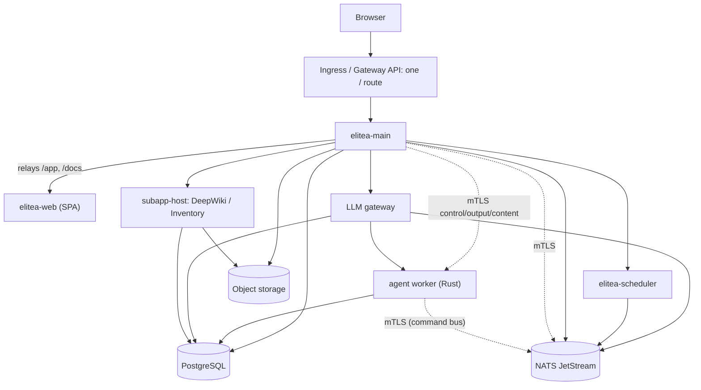

Elitea's Kubernetes path is one Helm chart, `elitea`, for everything: the platform, NATS JetStream with its stream bootstrap, the vector store and, where a cluster needs it, the sandbox-runtime installer. ArgoCD syncs it as one Application through an app-of-apps root. This page is the map; [Deploy from scratch](/deployment/from-scratch) walks a complete first install, [Install with Helm](/deployment/helm-install) is the shorter reference, and [Deploy on GKE with Argo CD](/deployment/gke-argocd) is the GitOps install on Google Cloud.

<Info title="Compose also exists">
A one-host Compose stack (`docker-compose.standalone-full.yml`) runs the same topology for evaluation and small teams — see [Install Elitea](/getting-started/install). This section covers the Kubernetes path only.
</Info>

## Target topology



Every arrow into the worker and the NATS command bus is mutually authenticated (mTLS; the command bus is NATS JetStream, elitea-main publishing as its own identity and the workers pulling from their own account) — that plane's material is described in [Install with Helm](/deployment/helm-install#secrets-to-create-beforehand) and `deploy/runtime/README.md`. DeepWiki and Inventory are two instances of the same `subapp-host` pattern: a Go host process reaching a Rust engine sidecar over a Unix socket inside one pod.

## What the chart creates, and what you bring

The chart is **one release** — elitea-main and its migration Job, elitea-web, the scheduler, the LLM gateway, the agent worker, the OTel collector, the database-preparation Job, the DeepWiki and Inventory provider services with their own migration Jobs, and the vector store: elitea-vector (`vector.enabled`) with Qdrant (`qdrant.enabled`, the upstream qdrant chart bundled like NATS), which indexing and the native DeepWiki and Inventory engines need. The runtime plane, the worker, the vector store, DeepWiki and Inventory are all on by default, one switch each (`<feature>.enabled: false` leaves one out). NATS JetStream and its bootstrap Job are in the same release (`nats.enabled`, on by default), ordered ahead of the workloads; the sandbox-runtime installer (`sandboxRuntime.enabled`) is off unless a k3s or EKS cluster needs gVisor on its nodes.

<CardGroup cols={2}>
  <Card title="PostgreSQL" icon="database">No chart provisions it. Point `postgresql.existingSecret` at a Secret holding the DSN; the database may start empty (the migration Job bootstraps the schema itself), but an administrator DSN is still needed for `CREATE DATABASE`. Plain PostgreSQL is enough: no extension, because every vector is in Qdrant.</Card>
  <Card title="cert-manager and secrets" icon="key">cert-manager must be installed: the bundled NATS CA, every NATS identity and the in-cluster mTLS hops are its `Certificate`s. Secrets come from you, or from your secret manager through the chart's `externalSecrets` block (External Secrets Operator).</Card>
  <Card title="Object storage" icon="package">An S3-compatible endpoint for artifacts and DeepWiki/Inventory output. The bucket must exist before the first sync (or set `objectInit.enabled: true` for a self-hosted S3-compatible store you administer directly); a missing bucket lets the deployment look green and then crash-loop on the next boot step.</Card>
  <Card title="Ingress" icon="route">No Ingress or HTTPRoute renders until `main.ingress.enabled` is on. Then it is one `/` rule with elitea-main as the sole backend, and that is the whole edge: elitea-main relays `/app` and `/docs` to elitea-web. Your ingress controller or Gateway, DNS and public certificate are yours; on GKE, `main.ingress.gke` adds what the Google load balancer needs.</Card>
  <Card title="OIDC/SAML identity provider, TLS" icon="shield-check">The chart consumes an authentication configuration document or `OIDC_ISSUER_URL`; it issues no certificates of its own beyond the in-cluster mTLS hops (cert-manager issuers, brought by you).</Card>
</CardGroup>

## Sizing: the PostgreSQL connection budget

The runtime plane (agent execution) opens **six isolated connection pools per elitea-main replica** — 36 connections beyond the primary pool — and they may not share capacity. `values-standalone.yaml` sizes for this explicitly: at `postgresql.maxConnections: 200` and `main.autoscaling.maxReplicas: 4`, four replicas cost roughly 4 × 42 = 168 connections, inside the 175 left after `reservedConnections: 25` (interactive `psql`, backup tooling, the migration and `dbInit` Jobs). The chart's own guard (`elitea-main.validateConnectionBudget`) refuses to render a topology that would exceed the stated ceiling, rather than letting it surface later as `FATAL: sorry, too many clients already` on whichever component connects next.

<Note>
When the server cannot hold the replicas you need, turn on the chart's transaction-mode PgBouncer (`pgbouncer.enabled`) and point the `elitea-main-db` DSN at its Service. Every elitea-main replica then shares one server-side pool. The migration Jobs, the gateway and the worker keep their direct connections, which `reservedConnections` covers.
</Note>

## Published artefacts

Every chart (`elitea`, and the standalone `elitea-sandbox-runtime`) and every first-party image is built, cosign-signed (keyless) and pushed to `ghcr.io/elitea-ng` by the release job in `.github/workflows/publish.yml`, after the images they reference are already pushed and signed.

```bash
helm install elitea oci://ghcr.io/elitea-ng/charts/elitea --version <tag>
```

Both charts are also listed on [Artifact Hub](https://artifacthub.io/packages/search?ts_query_web=elitea). The listing shows the values reference and every version, with pre-releases marked. It also shows a security report on the images that version ships. The listing reads the same OCI charts; it is not a second copy.

<Steps>
<Step title="Charts have no `latest` tag">
An OCI chart reference resolves by SemVer, so `--version <tag>` is required in practice — there is no floating tag to fall back on.
</Step>
<Step title="`image.tag` is stamped at package time">
The in-repo chart defaults to `"latest"`; the published chart's `image.tag` is rewritten to the release version so it never installs a stale cached layer.
</Step>
<Step title="Verify the signature">
```bash
cosign verify ghcr.io/elitea-ng/charts/elitea:<tag> \
  --certificate-identity-regexp '^https://github.com/elitea-ng/elitea-platform/' \
  --certificate-oidc-issuer https://token.actions.githubusercontent.com
```
Image manifests verify the same way, against `ghcr.io/elitea-ng/<component>:<tag>`. Every image and chart also carries signed SLSA build provenance, and every image a CycloneDX SBOM. [Verify release artifacts](/deployment/verify-artifacts) shows how to check them, and how to enforce them at admission.
</Step>
</Steps>

<Note>
If any part of a release fails, the rollback job deletes the pushed charts along with the images — a chart never stays published pointing at an image that got rolled back.
</Note>

Continue to [Install with Helm](/deployment/helm-install) for the step-by-step install, or [GitOps with ArgoCD](/deployment/argocd) if you are deploying through the app-of-apps.

{/* source: deploy/README.md:163-431 (chart table, composition decision, distribution); deploy/helm/elitea/values-standalone.yaml:1-20 (connection budget); deploy/helm/elitea/values.yaml:80-136 (postgresql.maxConnections, reservedConnections); deploy/helm/elitea/Chart.yaml (chart description, dependencies); .github/workflows/publish.yml (chart matrix); docs/UPGRADING.md (one chart, one edge route) */}
