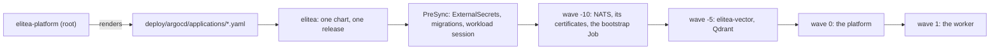

`deploy/argocd/` is the GitOps composition for the Kubernetes path: one root `Application` that renders every child `Application` under `deploy/argocd/applications/`. There is one child, `elitea`, because there is one chart: the platform, NATS JetStream with its stream bootstrap, and the vector store are all in the `elitea` chart. There is no umbrella chart; an earlier one (`deploy/helm/elitea-platform/`) was scaffolded and never built, and was removed once app-of-apps replaced it.

<Info title="Installing on GKE?">
[Deploy on GKE with Argo CD](/deployment/gke-argocd) is the complete walkthrough, with a copyable example in `deploy/argocd/examples/gke/`: the published OCI chart, `values-gke.yaml`, secrets from Google Secret Manager through External Secrets, and the GKE Ingress.
</Info>

## Apply the root once

```bash
kubectl apply -f deploy/argocd/app-of-apps.yaml
```

This is the only object you apply by hand. `kubectl apply -f deploy/argocd/` (no `-R`) reaches only this file — the children come from ArgoCD reading the directory, not from a second `kubectl apply`. The root itself is deliberately not one of the children it manages: an `Application` that enumerated itself could prune itself.



## Sync order inside the one Application

| Phase | Objects | Why this order |
|---|---|---|
| `PreSync` | the ExternalSecrets, when `externalSecrets.enabled` (wave `-30`); the database preparation, the platform and agent-state migrations; the workload-session Job (wave `10`) | The Secrets exist before the Jobs that read them. A failed migration aborts the sync, and the previous pods keep serving. |
| wave `-10` | the NATS StatefulSet and Services, its CA `Issuer`, server and route certificates, NetworkPolicy, and the `elitea-nats-bootstrap` Job, a `Sync` hook | The streams, KV buckets and the scheduler's consumer exist before anything that dials them. The Job is a `Sync` hook, not `PostSync`: `PostSync` would wait for workloads that wait for the streams it creates. It is idempotent, and Argo CD deletes it once it succeeds. |
| wave `-5` | elitea-vector and Qdrant | The indexing runtime's store, ready before the worker. |
| wave `0` | elitea-main, elitea-web, the scheduler, the LLM gateway, the OTel collector, the edge objects | The platform. |
| wave `1` | the agent worker | After everything it calls. |

cert-manager is a prerequisite: the NATS CA and every NATS identity are cert-manager `Certificate`s, issued from the chart's own namespaced `elitea-nats-ca` Issuer. That Issuer is why NATS lives in the platform's namespace. To use a NATS you run yourself, set `nats.enabled: false` and point `natsClient.*` at it; the bootstrap Job still runs against it unless `natsBootstrap.enabled: false`.

<Note title="Coming from three Applications?">
Installs that ran `elitea-nats`, `elitea-nats-bootstrap` and `elitea` as separate Applications move to the one chart with the steps in "One chart: NATS bundled" in [`docs/UPGRADING.md`](https://github.com/elitea-ng/elitea-platform/blob/main/docs/UPGRADING.md). Do not just delete the two NATS manifests: the root prunes them, and their finalizers would delete every NATS resource. The steps detach them first and keep the JetStream volume.
</Note>

## Where each value comes from

`deploy/argocd/applications/elitea.yaml` states every value in one `spec.source.helm` block — nothing reaches the release from anywhere else:

<Steps>
<Step title="Chart defaults">
`valueFiles: [values.yaml]`, read from the chart's own repository path.
</Step>
<Step title="Stated parameters">
`postgresql.existingSecret` and `postgresql.key` — the one database Secret every component derives its `DATABASE_URL` from. NATS needs no parameter: the chart runs it as Service `elitea-nats` in the Application's namespace and issues each client its certificate.
</Step>
<Step title="The empty parameters you must fill in">
`llmGateway.env.GATEWAY_SELF_LLM_ORIGINS` and `llmGateway.egressPosture` ship empty in git on purpose — neither can get a safe chart default — and so does the namespace of whatever forwards outside traffic to elitea-main (`networkPolicies.main.ingressFrom`). Left empty, the chart refuses to render and the Application reports `SyncFailed` naming the field, rather than installing a gateway with a disarmed guard.
</Step>
</Steps>

Fill the empty parameters in your own GitOps copy of the file, or imperatively:

```bash
argocd app set elitea \
  -p llmGateway.env.GATEWAY_SELF_LLM_ORIGINS=https://elitea.example.com/llm/v1 \
  -p llmGateway.egressPosture=public-unrestricted
```

<Warning>
No secret goes in a parameter. A Helm parameter renders into a ConfigMap, readable by anyone with `get` on the namespace — the database DSN and every other sensitive value are Kubernetes Secrets that `postgresql.existingSecret`, `runtime.material.secretName` and the rest only *name*. In production, let the chart's `externalSecrets` block fill those Secrets from your secret manager.
</Warning>

## Overriding values per environment

To point an environment at a different capability set — `values-standalone.yaml`, `values-gke.yaml`, `values-nats-ha.yaml` for three NATS nodes, or your own file — add it to `spec.source.helm.valueFiles` in that environment's copy of `elitea.yaml`, after `values.yaml` (Helm merges files in list order, so later files win):

```yaml
spec:
  source:
    helm:
      valueFiles:
        - values.yaml
        - values-standalone.yaml
      parameters:
        - name: platform.aiProjectId
          value: "1"
```

Keep one `Application` manifest per environment (a `staging/elitea.yaml`, a `prod/elitea.yaml`, or separate branches/paths per ArgoCD `Application`'s `targetRevision`) rather than templating the Application itself — the file is already the full statement of what an environment installs.

## Source the published chart

`applications/elitea.yaml` syncs the chart from this repository's `main`, which suits a development cluster. A production environment should pin a **release** of the published chart instead:

```yaml
spec:
  source:
    repoURL: ghcr.io/elitea-ng/charts   # registered in Argo CD with enableOCI
    chart: elitea
    targetRevision: "1.2.3"             # an exact release; there is no latest
    helm:
      valueFiles:
        - values-gke.yaml               # value files ship inside the chart
```

The published chart carries its dependencies (the upstream NATS chart and the sandbox-runtime installer), so an OCI source needs nothing else and is the recommended source. A git source (`path: deploy/helm/elitea`) has no `charts/` (it is never committed): Argo CD runs `helm dependency build` itself from the committed `Chart.lock`, which needs the NATS chart repository reachable from the repo-server and, in an AppProject that restricts `sourceRepos`, listed there:

```yaml
spec:
  sourceRepos:
    - https://github.com/<your-organisation>/<your-fork>   # or this repository
    - https://nats-io.github.io/k8s/helm/charts/           # the nats dependency
```

In an air-gapped cluster, mirror the published OCI chart instead.

`deploy/argocd/examples/gke/` has the full Application, the repository registration and an example `ClusterSecretStore`.

## Image tag promotion

Every first-party image and every chart is stamped with the same release version by `.github/workflows/publish.yml`'s semantic-release run — one tag for the whole platform, because a per-component tag could only ever express a mistake. Promoting a release is changing the chart version an `Application` pulls:

```bash
argocd app set elitea --revision <new-version>   # an OCI chart source
  # or, for a git source, edit spec.source.targetRevision to the release tag
```

The published chart's own `image.tag` already defaults to the chart's version — only override `image.tag` to pin an environment behind the chart's own release, or to test a release candidate. Read the entries in [`docs/UPGRADING.md`](https://github.com/elitea-ng/elitea-platform/blob/main/docs/UPGRADING.md) between the two versions first.

## Rollback

ArgoCD's own history covers a `sync` gone wrong:

```bash
argocd app rollback elitea <history-id>
```

For a release-level rollback (a bad image), point the `Application` back at a previous chart version and let `selfHeal: true` reconcile it — the chart's own migration hook still runs on the way there, so a rollback that also needs a schema rollback is a database operation, not something this reconciliation does for you. If a CI release itself failed mid-publish, the rollback job in `publish.yml` already deleted the charts and images it had pushed, so there is nothing half-published to roll back to.

## Your own GitOps repository

The `deploy/argocd/` and `deploy/helm/` in this repository are the **template**. A production deployment rolls from a GitOps repository your organisation owns, which layers its own values on top of the published chart and gets its secrets from a secret manager — nothing in this repository points at any particular environment. Copy `deploy/argocd/examples/gke/` (or the structure of `deploy/argocd/`) into that repository rather than syncing this one.

<Note>
`syncPolicy.automated` with `prune: true` and `selfHeal: true` is set on every Application here, including the root. Removing a file from `applications/` is a production deletion of that Application and everything it manages — review those diffs as such.
</Note>

{/* source: deploy/argocd/app-of-apps.yaml; deploy/argocd/applications/elitea.yaml; deploy/argocd/examples/gke/; deploy/helm/elitea/Chart.yaml (dependencies); deploy/helm/elitea/templates/nats/, templates/natsBootstrap/job.yaml (wave -10, Sync hook); deploy/helm/elitea/templates/externalSecrets/externalsecrets.yaml (PreSync, wave -30); deploy/helm/tests/render-nats-security.sh (argocd wave checks); docs/UPGRADING.md ("One chart: NATS bundled"); deploy/README.md (composition decision, publish.yml stamping) */}
