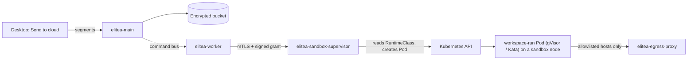

The cloud executor runs a desktop Local work thread after its owner chooses **Send to cloud**. Each cloud turn gets its own Pod, the *workspace run*, in which the agent builds and runs the user's project. That Pod runs untrusted code, so it must never share the node kernel. It runs under a sandboxing RuntimeClass (gVisor or Kata) on dedicated sandbox nodes. The supervisor refuses everything else.

This page assumes the platform is already installed ([Deploy from scratch](/deployment/from-scratch)). It adds:

| Piece | Comes from |
|---|---|
| Sandbox nodes and a RuntimeClass whose handler is `runsc`, `gvisor` or `kata*` | your platform (GKE, AKS), or the `elitea-sandbox-runtime` chart (EKS, k3s) |
| The sandbox supervisor and its `workspace` profile | the `elitea` chart (`sandboxKubernetes.*`) |
| The worker's side of workspace runs | the `elitea` chart (`worker.runtime.workspaceRuns`) |
| The egress proxy for projects with a host allowlist | the `elitea` chart (`egressProxy.*`) |
| An object store with default encryption at rest | **you** |
| The supervisor's certificate, the run-token keys | **you** (one script below) |



<Warning title="The elitea chart never touches nodes">
The `elitea` chart creates no RuntimeClass and installs nothing on a node. The sandbox runtime is either part of your platform or comes from the separate, privileged `elitea-sandbox-runtime` chart, which you install on purpose.
</Warning>

## Step 1: sandbox nodes and the runtime

Pick your platform. Each tab ends with the three values the `elitea` chart needs: `runtimeClass.name`, `nodeSelector` and `tolerations`.

<Tabs>
<Tab title="GKE">

Create a GKE Sandbox node pool. GKE installs gVisor on it, taints it with `sandbox.gke.io/runtime=gvisor:NoSchedule` and creates the `gvisor` RuntimeClass, whose scheduling adds the matching toleration to every Pod that asks for it. No installer is needed.

```bash
gcloud container node-pools create elitea-sandbox \
  --cluster "$CLUSTER" --region "$REGION" \
  --sandbox type=gvisor \
  --machine-type e2-standard-8 --num-nodes 1 \
  --node-labels elitea.ai/sandbox=true
```

In Terraform, this is `node_config { sandbox_config { sandbox_type = "gvisor" } }` on the node pool.

```yaml
sandboxKubernetes:
  runtimeClass:
    name: gvisor
  workspaceRuns:
    nodeSelector:
      sandbox.gke.io/runtime: gvisor
    tolerations: []   # the gvisor RuntimeClass adds GKE's toleration
```

</Tab>
<Tab title="AKS">

Add a Pod Sandboxing node pool (Kata VM isolation on Azure Linux). AKS installs Kata and registers the `kata-vm-isolation` RuntimeClass. Older clusters name it `kata-mshv-vm-isolation`. No installer is needed.

```bash
az aks nodepool add \
  --resource-group "$RG" --cluster-name "$CLUSTER" --name sandbox \
  --os-sku AzureLinux --workload-runtime KataVmIsolation \
  --node-vm-size Standard_D8s_v5 --node-count 1 \
  --labels elitea.ai/sandbox=true \
  --node-taints elitea.ai/sandbox=true:NoSchedule
kubectl get runtimeclass   # note the kata-* name
```

```yaml
sandboxKubernetes:
  runtimeClass:
    name: kata-vm-isolation      # or kata-mshv-vm-isolation
  workspaceRuns:
    nodeSelector:
      elitea.ai/sandbox: "true"
    tolerations:
      - {key: elitea.ai/sandbox, operator: Equal, value: "true", effect: NoSchedule}
```

</Tab>
<Tab title="EKS">

EKS ships no sandbox runtime. Create a labelled and tainted node group on the **Amazon Linux 2023** AMI, then install gVisor with the `elitea-sandbox-runtime` chart in `containerd` mode. Bottlerocket is not supported: its root file system is read-only.

```yaml
# eksctl ClusterConfig excerpt
managedNodeGroups:
  - name: elitea-sandbox
    amiFamily: AmazonLinux2023
    instanceType: m6i.2xlarge
    desiredCapacity: 1
    labels: {elitea.ai/sandbox: "true"}
    taints:
      - {key: elitea.ai/sandbox, value: "true", effect: NoSchedule}
```

```bash
kubectl create namespace elitea-sandbox-runtime
kubectl label namespace elitea-sandbox-runtime pod-security.kubernetes.io/enforce=privileged
helm install sandbox-runtime oci://ghcr.io/elitea-ng/charts/elitea-sandbox-runtime \
  --version "$CHART_VERSION" -n elitea-sandbox-runtime --set mode=containerd
kubectl -n elitea-sandbox-runtime rollout status ds/sandbox-runtime-installer
```

The installer writes `/etc/containerd/config.d/50-elitea-runsc.toml`. If needed, it adds that directory to `imports` in `/etc/containerd/config.toml`. It checks with `containerd config dump` that nothing else changes, then restarts containerd once.

```yaml
sandboxKubernetes:
  runtimeClass:
    name: gvisor
  workspaceRuns:
    nodeSelector:
      elitea.ai/sandbox: "true"
    tolerations:
      - {key: elitea.ai/sandbox, operator: Equal, value: "true", effect: NoSchedule}
```

</Tab>
<Tab title="k3s">

Label and taint the sandbox node, then install gVisor with the `elitea-sandbox-runtime` chart in `k3s` mode, the chart's default.

```bash
kubectl label node sandbox-1 elitea.ai/sandbox=true
kubectl taint node sandbox-1 elitea.ai/sandbox=true:NoSchedule
kubectl create namespace elitea-sandbox-runtime
kubectl label namespace elitea-sandbox-runtime pod-security.kubernetes.io/enforce=privileged
helm install sandbox-runtime oci://ghcr.io/elitea-ng/charts/elitea-sandbox-runtime \
  --version "$CHART_VERSION" -n elitea-sandbox-runtime
kubectl -n elitea-sandbox-runtime rollout status ds/sandbox-runtime-installer
```

What the installer does on the node:

1. It installs a pinned gVisor release, checked against the chart's SHA-512 and the release's published checksum, as `/usr/local/bin/runsc`, `/usr/local/bin/containerd-shim-runsc-v1` and the sidecars runsc needs in `/usr/local/bin/gvisor-bin/`.
2. It writes `/var/lib/rancher/k3s/agent/etc/containerd/config-v3.toml.tmpl` (or `config.toml.tmpl` on containerd 1.7): k3s's own base template (`{{ template "base" . }}`) plus a marked `runsc` runtime block. Content you already have there is kept.
3. It restarts `k3s-agent`, or `k3s` on a server node, once, and waits for k3s to render the runtime into `config.toml`. If k3s does not come back, the previous template is restored.

To do the same by hand, unpack the release archive (`runsc`, `containerd-shim-runsc-v1` and the `gvisor-bin/` directory) into `/usr/local/bin` and write this template, then run `systemctl restart k3s-agent`:

```toml
{{ template "base" . }}

[plugins.'io.containerd.cri.v1.runtime'.containerd.runtimes.runsc]
  runtime_type = "io.containerd.runsc.v1"
```

On containerd 1.7 (config version 2), the table is `[plugins."io.containerd.grpc.v1.cri".containerd.runtimes.runsc]` in `config.toml.tmpl`. Then create the RuntimeClass yourself: `handler: runsc`, with `scheduling.nodeSelector` and `tolerations` for the sandbox node.

```yaml
sandboxKubernetes:
  runtimeClass:
    name: gvisor
  workspaceRuns:
    nodeSelector:
      elitea.ai/sandbox: "true"
    tolerations:
      - {key: elitea.ai/sandbox, operator: Equal, value: "true", effect: NoSchedule}
```

</Tab>
</Tabs>

Check the runtime before going on:

```bash
kubectl get runtimeclass -o custom-columns=NAME:.metadata.name,HANDLER:.handler
kubectl run sandbox-check --rm -it --restart=Never --image=busybox:1.36 \
  --overrides='{"spec":{"runtimeClassName":"gvisor","nodeSelector":{"elitea.ai/sandbox":"true"},"tolerations":[{"key":"elitea.ai/sandbox","operator":"Exists"}]}}' \
  -- dmesg | head -3
```

Under gVisor, `dmesg` prints gVisor's own boot lines ("Starting gVisor..."), not the host kernel's. Use your RuntimeClass name and node selector.

<Note title="The supervisor checks the handler itself">
Before it creates any workspace-run Pod, the supervisor reads the RuntimeClass named in `sandboxKubernetes.runtimeClass.name` and accepts only the handlers `runsc`, `gvisor` and `kata*`. It checks at start and again before each run. A missing RuntimeClass, a read the API server refuses, and `runc` or `crun` refuse every workspace run, with `workspace_run_runtime_class_refused` in its log (and `workspace_run_runtime_class_unverified` at start). The supervisor itself keeps running, so its other profiles keep working, and a fixed RuntimeClass is picked up within seconds, without a restart. The chart grants it `get` on that one RuntimeClass, and nothing else cluster-wide.
</Note>

## Step 2: the bucket

Workspace segments are stored in the platform's bucket, or in `STORAGE_WORKSPACE_BUCKET` if you set one. Send to cloud stays off until Main confirms at startup that every such bucket has **default encryption at rest**.

```bash
aws s3api put-bucket-encryption --bucket "$BUCKET" \
  --server-side-encryption-configuration \
  '{"Rules":[{"ApplyServerSideEncryptionByDefault":{"SSEAlgorithm":"aws:kms"},"BucketKeyEnabled":true}]}'
aws s3api get-bucket-encryption --bucket "$BUCKET"
```

<Warning title="RustFS">
RustFS 1.0.0-beta.8 implements default SSE-S3 without a KMS, but its master key is a built-in all-zero key unless you set `RUSTFS_SSE_S3_MASTER_KEY` (base64 of 32 random bytes) in the RustFS container. Set the key **before** you add the bucket rule: objects written under one key cannot be read after it changes, so back the key up with your other secrets. The same release also refuses a multipart upload part that carries a checksum into an encrypted bucket. Set `main.env.AWS_REQUEST_CHECKSUM_CALCULATION: when_required`. Main then sends a checksum only where it asks for one (the presigned SHA-256 uploads of workspace segments), so its other uploads go without a per-request integrity check. Leave it empty on AWS S3 and on any store that accepts checksummed parts.
</Warning>

<Note title="A store the desktop cannot reach">
By default the desktop app uploads and downloads workspace segments with presigned URLs on `S3_ENDPOINT_URL`. That works for AWS S3, or for a store behind an HTTPS ingress. For an in-cluster store with no public address, such as `http://rustfs:9000`, the desktop refuses the URL with "the store handed out a URL this client does not use". Set `main.env.S3_PRESIGN: "false"`, and the desktop streams segments through Main instead. The switch covers the whole store, so artifact transfer grants also go through Main. The worker is not affected: it always reaches the store through Main.

Three things follow:

- Each segment goes up in one request, with no multipart upload. Main's ingress must accept a body as large as the largest segment. Traefik has no limit by default. On ingress-nginx, set `nginx.ingress.kubernetes.io/proxy-body-size` on Main's ingress.
- Main writes those segments to the store as multipart uploads of its own. On RustFS with default encryption, also set `AWS_REQUEST_CHECKSUM_CALCULATION: when_required` (see the warning above).
- Bytes move through Main, so size Main's network and CPU for them.
</Note>

The platform's IAM policy needs `s3:GetEncryptionConfiguration` on the bucket, in addition to the object permissions it already has. A bucket without a default rule is refused. Some S3-compatible stores do not implement `GetBucketEncryption`. For those only, an operator can attest the encryption with `main.env.ELITEA_CLOUD_EXECUTOR_STORAGE_ENCRYPTION_ATTESTED: "true"`. Main logs the attestation at startup and records it in the audit trail.

## Step 3: keys, certificates and the supervisor material

The worker dials the supervisor over mTLS: the worker presents its runtime client certificate, and the supervisor presents a server certificate for `elitea-sandbox-workspace`. Both chain to the **runtime CA**. Main signs a grant for each run, and the supervisor verifies it with Main's public command-signing keyring. The egress proxy admits a run with a token Main signs with a separate Ed25519 key.

```bash
NS=elitea
# 1. The supervisor's server certificate, from the runtime CA (or a cert-manager
#    Certificate on the elitea-runtime-ca issuer, copied into the Secret below).
openssl req -new -newkey rsa:2048 -nodes -keyout workspace-server.key \
  -subj "/CN=elitea-sandbox-workspace" -out workspace.csr
printf 'basicConstraints=critical,CA:FALSE\nkeyUsage=critical,digitalSignature,keyEncipherment\nextendedKeyUsage=serverAuth\nsubjectAltName=DNS:elitea-sandbox-workspace,DNS:elitea-sandbox-workspace.%s.svc\n' "$NS" > workspace.ext
openssl x509 -req -in workspace.csr -CA runtime-ca.crt -CAkey runtime-ca.key \
  -set_serial "0x$(openssl rand -hex 16)" -days 90 -sha256 -extfile workspace.ext \
  -out workspace-server.crt

# 2. The supervisor material: one Secret, flat keys. The client CA verifies
#    the worker's certificate; the keyring is Main's PUBLIC keyring
#    (command-signing-keyring.json), never the signing key.
kubectl -n "$NS" create secret generic elitea-sandbox-material \
  --from-file=workspace-client-ca.pem=runtime-ca.crt \
  --from-file=workspace-server.crt=workspace-server.crt \
  --from-file=workspace-server.key=workspace-server.key \
  --from-file=workspace-grant-keyring.json=command-signing-keyring.json

# 3. The run-token key pair for the egress proxy (OpenSSL 3).
openssl genpkey -algorithm ed25519 -out signing.pem
openssl pkey -in signing.pem -pubout -out signing.pub.pem
kubectl -n "$NS" create secret generic elitea-egress-token-signing --from-file=signing.pem=signing.pem
kubectl -n "$NS" create secret generic elitea-egress-proxy-keys --from-file=2026-10.pem=signing.pub.pem
shred -u signing.pem workspace-server.key
```

The proxy's **audit certificate** (`egressProxy.audit`) is a cert-manager `Certificate` that the chart creates on the runtime CA. The chart's default names a `ClusterIssuer`. [Deploy from scratch](/deployment/from-scratch) creates a namespaced `Issuer` called `elitea-runtime-ca`, so the values below set `egressProxy.audit.issuerRef.kind: Issuer`. Without it the certificate never issues and the proxy never becomes Ready.

The supervisor reads the material once, at start. After a rotation, run `kubectl rollout restart deploy/elitea-sandbox-supervisor`. The material Secret must not contain a key named `workspace.json`: that name is reserved for the profile the chart renders.

## Step 4: the values

A k3s cluster with one tainted sandbox node labelled `elitea.ai/sandbox=true`. For another platform, swap the three values from Step 1.

```yaml
main:
  runtime:
    # Main signs workspace-run grants for this audience.
    sandboxAudiences: ["dns:elitea-sandbox-workspace"]

worker:
  runtime:
    workspaceRuns:
      target: elitea-sandbox-workspace:9470       # the profile's Service
      audience: dns:elitea-sandbox-workspace
      scratch_root: /var/lib/elitea-worker/workspace-scratch
      cpu_millis: 2000
      memory_bytes: 4294967296
      max_disk_bytes: 10737418240
      turn_wall_seconds: 3600
    # The worker's own disk for scratch_root (an emptyDir of this size).
    workspaceScratchSizeLimit: 30Gi

sandboxKubernetes:
  enabled: true
  executionNamespace: elitea-code-execution
  runtimeClass:
    name: gvisor
  workspaceRuns:
    enabled: true
    nodeSelector:
      elitea.ai/sandbox: "true"
    tolerations:
      - {key: elitea.ai/sandbox, operator: Equal, value: "true", effect: NoSchedule}
    profile:
      image: ghcr.io/elitea-ng/elitea-workspace-runner@sha256:<digest>
      # Defaults shown: port 9470, serviceName elitea-sandbox-workspace,
      # concurrency 16, 10 GiB workspace, 4 CPUs, 8 GiB, one hour.
    # Direct internet for projects whose network is on and that have no
    # host allowlist. Leave it off to allow only allowlisted hosts (through
    # the proxy) or none.
    egress:
      enabled: true
      podCidrs: [10.42.0.0/16]       # k3s defaults; use your cluster's
      serviceCidrs: [10.43.0.0/16]
  supervisor:
    enabled: true
    image: ghcr.io/elitea-ng/elitea-sandbox-supervisor@sha256:<digest>
    materialSecret: elitea-sandbox-material
    profiles: []                      # the cloud executor only

egressProxy:
  enabled: true
  signingKey:
    existingSecret: elitea-egress-token-signing
  publicKeys:
    existingSecret: elitea-egress-proxy-keys
  audit:
    issuerRef: {name: elitea-runtime-ca, kind: Issuer}
```

Take the digests from the release you install: `crane digest ghcr.io/elitea-ng/elitea-sandbox-supervisor:<version>`, and the same for `elitea-workspace-runner`. From these values the chart renders the supervisor's `workspace` profile into a ConfigMap, projects it beside the material Secret, and creates the `elitea-sandbox-workspace` Service. It also gives the worker its scratch volume and tells Main that an executor exists (`ELITEA_CLOUD_EXECUTOR_CONFIGURED`). The render fails if workspace runs are only partly enabled: without the supervisor, without `worker.runtime.workspaceRuns`, without a RuntimeClass, or with an audience or target that does not match.

## Step 5: turn it on

Send to cloud needs four switches, all on. If one is off, the desktop says which one.

| Switch | Where | Reason shown when off |
|---|---|---|
| Cloud executor: **Enabled** | Admin, Configuration, *Cloud executor* (`cloud_executor.enabled`) | `platform_off` |
| The project's own on/off: its explicit value, or else **Default for Projects** | Default: Admin, Configuration, *Cloud executor* (`cloud_executor.project_default_enabled`; off on a new install, see the upgrade rule below). Explicit: Admin, Projects, a project's *Send to cloud* action (any project), or the project's Settings, General, *Send to cloud* (its project admin). Both store `enabled` in the project's `cloud_executor` setting; *Use the default for projects* removes it | `project_off` |
| Native client policy: `local_work_allowed` and `local_work_cloud_handoff` | Admin, Configuration, *Native client policy*, Local work | `device_off` |
| A configured executor and confirmed bucket encryption | Steps 2 to 4 | `no_executor`, `storage_encryption_unconfirmed` |

**Enabled** always wins: while it is off, Send to cloud is off in every project, whatever the project says. While it is on, a project that turned it on or off keeps its choice, and a project that never chose follows **Default for Projects**. That includes every project that existed before this switch, so turning **Enabled** on with the default off (the default) turns Send to cloud on nowhere yet. Turn it on per project, or turn the default on to open it everywhere and let projects opt out. `project_off` covers both an explicit off and a default that is off.

**Upgrade rule.** Until an administrator saves **Default for Projects**, it equals the saved **Enabled**. A new install has neither saved, so both are off. A deployment upgraded with **Enabled** already on keeps Send to cloud on in every project without its own value, as before the switch existed, and the Configuration page shows **Default for Projects** on. Once you save the field, the saved value wins, whatever **Enabled** is. Saving other fields of the form does not save it. To close Send to cloud by default after an upgrade, turn **Default for Projects** off and save.

The project setting's other fields (shell, network and its allowlist, history, caps, exclusions and environment rules) can only narrow the platform values.

The *Cloud executor* section also sets the sandbox ceilings: shell, network and its host allowlist, full history, the segment and file caps, idle retention and return grace, and the exclusions and environment rules.

## Step 6: verify

```bash
# The runtime class and the supervisor's verdict on it.
kubectl get runtimeclass gvisor -o jsonpath='{.handler}{"\n"}'
kubectl -n elitea logs deploy/elitea-sandbox-supervisor | grep -E 'workspace_run_runtime_class_(verified|refused)'

# Main's view for a project: enabled true, disabled_reason null.
curl -s -H "Authorization: Bearer $TOKEN" \
  "$DEPLOYMENT_URL/api/v2/elitea_core/workspace_handoff_policy/prompt_lib/$PROJECT_ID" | jq '{enabled, disabled_reason}'

# The project's own switch: explicit true/false, or null and source "default".
curl -s -H "Authorization: Bearer $TOKEN" \
  "$DEPLOYMENT_URL/api/v2/elitea_core/project_cloud_executor/prompt_lib/$PROJECT_ID" | jq
```

Then send a Local work thread from the desktop app and start a turn. While it runs:

```bash
kubectl -n elitea-code-execution get pods -l sandbox.elitea.ai/kind=workspace-run -o wide
POD=$(kubectl -n elitea-code-execution get pods -l sandbox.elitea.ai/kind=workspace-run -o name | head -1)
kubectl -n elitea-code-execution get "$POD" -o jsonpath='{.spec.runtimeClassName} {.spec.nodeName}{"\n"}'
kubectl -n elitea-code-execution exec "$POD" -c workspace -- dmesg | head -2
```

The Pod runs on a sandbox node with your RuntimeClass, and `dmesg` shows gVisor, not the host. A project with a host allowlist reaches only those hosts. `egress_proxy.run_summary` in the proxy's log, and the turn's audit event in Main, list the hosts reached and refused.

To prove the refusal, point `sandboxKubernetes.runtimeClass.name` at a RuntimeClass with `handler: runc` in a test cluster. The supervisor must refuse every workspace run, with `workspace_run_runtime_class_refused` in its log.

## Troubleshooting

| Symptom | Cause |
|---|---|
| "turned off for this deployment" (`platform_off`) | The *Cloud executor* section is not enabled |
| "turned off for this project" (`project_off`) | The project turned it off, or never chose and **Default for Projects** is off |
| "no cloud executor set up" (`no_executor`) | `sandboxKubernetes.workspaceRuns` or the supervisor is off. For a supervisor outside the chart, set `main.env.ELITEA_CLOUD_EXECUTOR_CONFIGURED: "true"` |
| "could not confirm that its storage is encrypted" | No default encryption rule, or the IAM policy lacks `s3:GetEncryptionConfiguration`. See Main's start-up log line `cloud executor: default encryption at rest ... is not confirmed` |
| Every cloud turn is refused, and the supervisor logs `workspace_run_runtime_class_refused` | The RuntimeClass is missing or not isolating, or the chart's ClusterRole was removed |
| A run fails with `workspace_run.unavailable` | `worker.runtime.workspaceRuns.target` does not reach the profile's Service, or the certificate SAN does not match it |
| The installer pod is not Ready | Read its init container's log: `kubectl -n elitea-sandbox-runtime logs <pod> -c install`. Backups of every config it replaced are in `/var/lib/elitea-sandbox-runtime/backup` on the node |
| Run Pods stay Pending | No node matches `nodeSelector`, or the taint is not tolerated. On GKE, the RuntimeClass adds the toleration |
