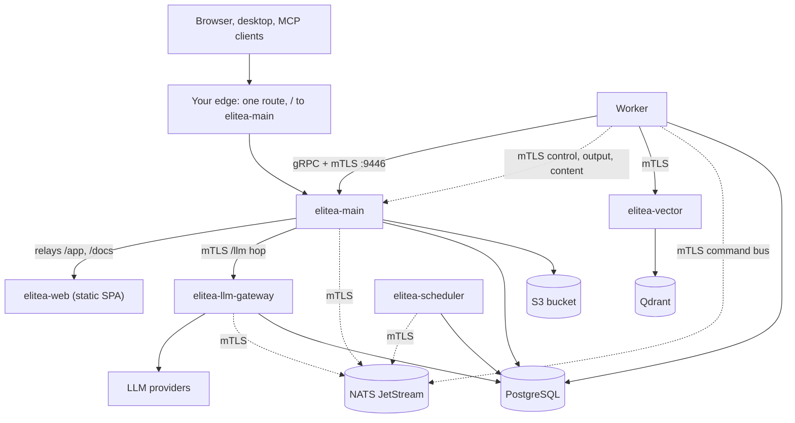

This page takes an empty Kubernetes cluster to a working Elitea deployment with single sign-on, chat, agents, indexing and shared models. Follow it top to bottom, once. It covers the same install as [Install with Helm](/deployment/helm-install), but in full: what to decide first, the secrets and certificate authorities the chart expects, and the edge in front of the platform. When you are done, [GitOps with ArgoCD](/deployment/argocd) shows how to keep the same install in git.

It targets the **one-chart** layout: a release whose [`docs/UPGRADING.md`](https://github.com/elitea-ng/elitea-platform/blob/main/docs/UPGRADING.md) has the entry "One chart: NATS bundled". NATS JetStream and its stream bootstrap are part of the `elitea` chart; earlier releases installed them from two separate charts, `nats` and `nats-bootstrap`, which are no longer published. A values file or a guide that still mentions those charts, `runtimeRedis`, `worker.implementation: python` or Redis passwords is out of date, and the chart refuses most of it.

Installing on Google Cloud? Read [Deploy on Google Cloud (GKE)](/deployment/gcp) alongside this page. It covers Cloud SQL, a GCS bucket without keys, the edge on GKE, and platform models authenticated by a service account. [Deploy on GKE with Argo CD](/deployment/gke-argocd) is the same install as one Argo CD Application, with secrets from Google Secret Manager.

## What you end up with



| Component | Comes from | Notes |
|---|---|---|
| elitea-main, elitea-web, elitea-scheduler, elitea-llm-gateway, elitea-worker, elitea-vector, Qdrant, OTel collector | the `elitea` chart | one release, one values file, one version |
| NATS JetStream and its streams | the `elitea` chart (`nats`, `natsBootstrap`) | bundled and on by default; same release, same namespace |
| PostgreSQL 16+ | **you** | an existing server, a managed service, or an operator such as CloudNativePG |
| S3-compatible bucket (or Azure Blob, GCS) | **you** | must exist before the first install |
| cert-manager | **you** | issues every in-cluster mTLS certificate |
| Ingress controller or Gateway API implementation, public TLS certificate, DNS | **you** | the public edge, one route to elitea-main; see [The edge](#step-7-the-edge) |
| OIDC identity provider (and optionally SAML, SCIM) | **you** | Keycloak, Entra ID, Okta, Dex, Google... |
| Model providers | **you** | OpenAI, Anthropic, Azure OpenAI, Gemini, or a self-hosted OpenAI-compatible server |

Every first-party image and chart is public on `ghcr.io/elitea-ng`, so no image pull secret is needed.

<Note title="No internal proxy, one edge route">
The worker and the DeepWiki and Inventory pods reach elitea-main over **gRPC** on a **private** mTLS listener (port 9446) that elitea-main serves itself, admitting only clients with a certificate from the runtime CA, and each gRPC service on it only the workload identities configured for it. It serves no HTTP; check it with gRPC health, not an HTTP probe. There is no internal proxy to run. In front, elitea-main is the browser edge too: it relays `/app` and `/docs` to elitea-web and serves its MCP endpoint itself, so your public edge needs exactly one route, `/` to elitea-main. Any Ingress controller or Gateway API implementation does, the managed GKE Ingress and Gateway included. See [The edge](#step-7-the-edge).
</Note>

## Before you start: decide these

Write the answers down. Every one ends up in a value or a Secret, and several are hard to change later.

| Decision | Example | Where it goes | Changing it later |
|---|---|---|---|
| Public hostname | `elitea.example.com` | `DEPLOYMENT_URL`, OIDC redirect URI, gateway self-origins, the edge route | edit values, re-register the redirect URI |
| Namespace | `elitea` | everything; NATS and its bootstrap are in the same release | reinstall |
| Chart version | the latest release | `--version` on the one chart | upgrade (read [`docs/UPGRADING.md`](https://github.com/elitea-ng/elitea-platform/blob/main/docs/UPGRADING.md) first) |
| PostgreSQL server and its `max_connections` | `pg.internal:5432`, `200` | the database DSN Secrets, `postgresql.maxConnections` | edit values; the chart re-checks the connection budget |
| Bucket and region | `elitea-artifacts`, `eu-west-1` | `STORAGE_*` / `S3_*` env | data does not move by itself |
| Identity provider and client | issuer URL, client id, client secret | `OIDC_*` env and a Secret | edit values |
| First administrator | `email:admin@example.com` | `ELITEA_INITIAL_GLOBAL_ADMINS` | add entries any time; nobody is ever demoted by this list |
| Worker identity (SPIFFE id) | `spiffe://elitea.example.com/ns/elitea/sa/worker` | the worker certificate, `worker.runtimeSession.expectedIdentity` | re-mint the worker certificate |
| Model provider hosts | `api.openai.com`, `10.0.5.20:8000` | `GATEWAY_EGRESS_ALLOWLIST` | edit values |

## Prerequisites

<CardGroup cols={2}>
  <Card title="Kubernetes" icon="server">A cluster whose CNI **enforces NetworkPolicy** (Calico, Cilium, and similar). The chart renders default-deny ingress policies and relies on them. `kubectl` and `helm`: Helm 4.3 or newer is recommended, and Helm 3.8 or newer (the first that pulls OCI charts) also works.</Card>
  <Card title="cert-manager" icon="shield-check">Installed cluster-wide before anything else. The bundled NATS, the LLM gateway, elitea-vector and the NATS client identities all render cert-manager `Certificate` objects.</Card>
  <Card title="PostgreSQL 16 or newer" icon="database">The agent-state migrations use SQL/JSON syntax introduced in 16. No extension is needed: every vector is kept in Qdrant through elitea-vector, not in PostgreSQL.</Card>
  <Card title="Object storage" icon="package">S3-compatible (AWS S3, MinIO, RustFS, Ceph RGW), Azure Blob or GCS. There is no local-disk backend.</Card>
  <Card title="An edge" icon="route">An Ingress controller, or a Gateway API implementation with a `Gateway` that terminates TLS for your hostname. It needs one route, `/` to elitea-main, that keeps long streams open.</Card>
  <Card title="An OIDC provider" icon="key">A confidential client with the redirect URI `https://<host>/auth/oidc/callback`. For GitHub, which has no OIDC sign-in, put Dex in front of it.</Card>
</CardGroup>

### Capacity

The worker dominates. The figures below are requests for the install on this page. Limits are higher.

| Component | Replicas | CPU request | Memory request | Storage |
|---|---|---|---|---|
| elitea-main | 2 (HPA to 3) | 100m | 256Mi | — |
| elitea-web | 2 | 10m | 32Mi | — |
| elitea-scheduler | 1 | 50m | 64Mi | — |
| elitea-llm-gateway | 1 | 250m | 1Gi | — |
| elitea-worker | 1 | 2 | 4Gi | — |
| elitea-vector | 2 | 250m | 128Mi | — |
| Qdrant | 1 (3 for HA) | 500m | 2Gi | 50Gi PVC |
| OTel collector | 1 | 50m | 128Mi | — |
| NATS (bundled, one node) | 1 (3 for HA) | 100m | 256Mi | 10Gi PVC |

Plan for about 4 CPU and 10Gi of memory in requests, and at least one node with 2 free CPUs for the worker during a rolling update.

## Step 1: Namespace and certificate authorities

Three private certificate authorities protect the in-cluster hops. None of them is your public certificate, and they must stay separate:

| Issuer | Signs | Created by |
|---|---|---|
| `elitea-nats-ca` | NATS server and every NATS client identity | the `elitea` chart, automatically |
| `elitea-internal-ca` | the elitea-main → LLM gateway mTLS hop | **you**, below |
| `elitea-runtime-ca` | elitea-vector certificates. It must be **the same CA** as the runtime material you mint in [Step 4](#step-4-mint-the-secrets) | **you**, below, from that material |

```bash
kubectl create namespace elitea
```

Apply the internal CA. cert-manager generates its key and nothing leaves the cluster:

```yaml
# internal-ca.yaml
apiVersion: cert-manager.io/v1
kind: Issuer
metadata: {name: elitea-internal-selfsigned, namespace: elitea}
spec: {selfSigned: {}}
---
apiVersion: cert-manager.io/v1
kind: Certificate
metadata: {name: elitea-internal-ca, namespace: elitea}
spec:
  secretName: elitea-internal-ca
  isCA: true
  commonName: elitea-internal-ca
  duration: 43800h
  privateKey: {algorithm: ECDSA, size: 256}
  issuerRef: {name: elitea-internal-selfsigned, kind: Issuer}
---
apiVersion: cert-manager.io/v1
kind: Issuer
metadata: {name: elitea-internal-ca, namespace: elitea}
spec:
  ca: {secretName: elitea-internal-ca}
---
# Backed by the runtime CA you mint in Step 4 (Secret elitea-runtime-ca).
apiVersion: cert-manager.io/v1
kind: Issuer
metadata: {name: elitea-runtime-ca, namespace: elitea}
spec:
  ca: {secretName: elitea-runtime-ca}
```

```bash
kubectl apply -f internal-ca.yaml
```

The chart's defaults name `ClusterIssuer`s. The values in [Step 6](#step-6-write-the-values-file) switch both references to these namespaced `Issuer`s, which read their CA from the platform's own namespace and need no access to cert-manager's namespace.

<Warning title="Who can create a Certificate can impersonate a service">
Anyone allowed to create a cert-manager `Certificate` or read Secrets in this namespace can mint a NATS or runtime identity. Limit those RBAC rights to the deployer and operators.
</Warning>

## Step 2: PostgreSQL

The platform needs one login role and **two databases**, both owned by that role:

| Database | Holds | Read by |
|---|---|---|
| `elitea_v2` (the platform database) | every platform schema (`centry`, `p_<id>` per project, `elitea_auth`, `elitea_runtime`, `gateway`, ...) | elitea-main, its migration Job, the scheduler, the LLM gateway, the workload-session Job |
| `elitea_v2_agentstate` | agent sessions and graph checkpoints | the worker, the agent-state migration Job |

The migration Job runs as the role and creates every schema itself, so the role needs **ownership** of the platform database and no superuser rights. Nothing is imported: the platform starts empty apart from what the migrations seed.

<Tabs>
<Tab title="Your DBA prepares it (recommended for managed PostgreSQL)">
Run once as an administrator:

```sql
CREATE ROLE elitea_v2 LOGIN PASSWORD '<db-password from Step 4>';
CREATE DATABASE elitea_v2 OWNER elitea_v2;
CREATE DATABASE elitea_v2_agentstate OWNER elitea_v2;
```

Then keep the chart's database-preparation hook off, and say that the databases exist:

```yaml
dbInit:
  enabled: false
  externallyManaged: true
```

Without `externallyManaged: true` the chart refuses to render. Otherwise the install would look healthy and then fail every agent turn with "The durable agent checkpoint store is unavailable".
</Tab>
<Tab title="The chart prepares the rest">
Create the role and the platform database yourself as above. Then let the `dbInit` hook create the agent-state database before each install and upgrade. It needs an administrator DSN with the `CREATE DATABASE` right **for the platform database**:

```bash
DSN='postgres://postgres:<pw>@pg.internal:5432/elitea_v2?sslmode=require'
kubectl -n elitea create secret generic \
  elitea-postgres-cluster-superuser --from-literal=uri="$DSN"
```

```yaml
dbInit:
  enabled: true
  appRole: elitea_v2
  agentStateDatabase: elitea_v2_agentstate
```

With CloudNativePG, a Cluster with `enableSuperuserAccess: true` publishes a Secret of this shape. Point `dbInit.database.existingSecret` at it.
</Tab>
</Tabs>

**TLS.** Put `sslmode=require` in both DSNs. The chart has no mount for a server CA bundle, so `verify-full` is not available yet. The DSN is a plain libpq URL. Generate the password URL-safe, as the Step 4 script does: a `/` or `+` in it breaks URL parsing, and the error then names a host or port instead of the password.

### The connection budget

PostgreSQL connections run out before CPU does. With the runtime plane on, each elitea-main replica opens one primary pool of 6 plus six isolated runtime pools totalling 36, and elitea-vector's introspection pool adds 8: **about 50 connections per replica**. The chart multiplies that by the autoscaler maximum and refuses to render when the total exceeds `postgresql.maxConnections - reservedConnections`. The reserve covers the scheduler, the gateway, the worker, the Jobs, backups and interactive `psql`.

| `max_connections` on the server | `reservedConnections` | Largest `main.autoscaling.maxReplicas` |
|---|---|---|
| 100 | 25 | 1 |
| 200 | 25 | 3 |
| 300 | 25 | 5 |

Read the real value with `SHOW max_connections;`. The chart cannot read it, so it believes the number in `postgresql.maxConnections`. A transaction-mode PgBouncer is shipped with the chart (`pgbouncer.enabled`) when you need more elitea-main replicas than the server can hold. Point `elitea-main-db` at the pooler's Service when you turn it on.

## Step 3: Object storage

Create the bucket **before the first install**. elitea-main's readiness probe tolerates a missing bucket. The boot step right after it does not: it writes the bucket's lifecycle rule. So with no bucket, the release reports success and elitea-main then crash-loops.

The credential elitea-main uses needs:

- `s3:GetObject`, `s3:PutObject`, `s3:DeleteObject`, `s3:ListBucket`
- `s3:PutLifecycleConfiguration`. elitea-main writes the rule `elitea-abort-incomplete-multipart-uploads` and **replaces the bucket's whole lifecycle configuration**. Use a dedicated bucket.
- `s3:GetEncryptionConfiguration`. Without it the platform still starts, but the cloud-executor handoff stays off.

```bash
kubectl -n elitea create secret generic elitea-main-storage-secrets \
  --from-literal=s3-access-key='<access key>' \
  --from-literal=s3-secret-key='<secret key>'
```

On AWS with IRSA, or on any cloud with workload identity, skip the Secret, remove the two `S3_*` entries from `main.secrets` in Step 6, and annotate `main.serviceAccount`. For a self-hosted MinIO, RustFS or Ceph that you administer, `objectInit.enabled: true` creates the bucket from the same Secret. Azure Blob and GCS use `STORAGE_BACKEND: azure` or `gcs` with their own variables. For GCS with Workload Identity, which needs no Secret, see [Deploy on Google Cloud](/deployment/gcp#gcs-bucket-with-no-keys). Uploads up to 150 MiB are accepted by default (`ARTIFACT_MAX_OBJECT_BYTES`).

## Step 4: Mint the secrets

Nothing secret belongs in a values file: a Helm value renders into a ConfigMap. The chart only takes **names** of Secrets you create.

### Generate the material

The script below writes every generated value into `./elitea-material`, owner-only. It needs OpenSSL 3, which is what produces the Ed25519 key. Keep the directory somewhere safe and **out of git**. Losing `secrets-master-key` makes every stored credential unreadable.

```bash
#!/usr/bin/env bash
# mint-elitea-material.sh — every generated value the chart needs.
set -euo pipefail

NS="${NS:-elitea}"
DIR="${DIR:-$PWD/elitea-material}"
DAYS="${DAYS:-825}"
WORKER_ID="${WORKER_ID:-spiffe://elitea.example.com/ns/elitea/sa/worker}"
KEY_ID="${KEY_ID:-elitea-runtime-v1}"
DB_HOST="${DB_HOST:-pg.internal}"
DB_ROLE="${DB_ROLE:-elitea_v2}"
DB_NAME="${DB_NAME:-elitea_v2}"

umask 077; mkdir -p "$DIR"; cd "$DIR"
if [ -f runtime-ca.crt ]; then
  echo "material exists in $DIR; delete it to rotate"; exit 0
fi

token()    { openssl rand -base64 32 | tr -d '\n=' ; }
urltoken() { openssl rand -base64 32 | tr '+/' '-_' | tr -d '\n=' ; }
sans() {   # every name a client may dial the Service by
  local s="$1"
  printf 'DNS:%s,DNS:%s.%s.svc,DNS:%s.%s.svc.cluster.local' \
    "$s" "$s" "$NS" "$s" "$NS"
}
sign() {   # stem, extensions: sign <stem>.csr with the runtime CA
  openssl x509 -req -in "$1.csr" -out "$1.crt" -days "$DAYS" \
    -CA runtime-ca.crt -CAkey runtime-ca.key -CAcreateserial \
    -extfile <(printf '%b' "$2") 2>/dev/null
}
SERVER_EXT='extendedKeyUsage=serverAuth
keyUsage=critical,digitalSignature,keyEncipherment'
CLIENT_EXT='extendedKeyUsage=clientAuth
keyUsage=critical,digitalSignature'

server_cert() { # stem, service
  openssl req -newkey rsa:2048 -nodes -subj "/CN=$2" \
    -keyout "$1.key" -out "$1.csr" 2>/dev/null
  sign "$1" "subjectAltName=$(sans "$2")\n$SERVER_EXT"
}

# The runtime CA signs elitea-main's runtime listeners (the platform
# listener on 9446 reuses content-server), the worker's identity, and
# (via cert-manager) elitea-vector.
openssl req -x509 -newkey rsa:2048 -nodes -days "$DAYS" \
  -subj "/CN=elitea-runtime-ca" \
  -keyout runtime-ca.key -out runtime-ca.crt \
  -addext "basicConstraints=critical,CA:TRUE" \
  -addext "keyUsage=critical,keyCertSign,cRLSign" 2>/dev/null
for stem in control-server output-server content-server; do
  server_cert "$stem" elitea-main
done

# The worker's client certificate: exactly ONE URI SAN, nothing else.
openssl req -newkey rsa:2048 -nodes -subj "/CN=elitea-agent-worker" \
  -keyout agent-worker-client.key -out agent-worker-client.csr 2>/dev/null
sign agent-worker-client "subjectAltName=URI:$WORKER_ID\n$CLIENT_EXT"

# (No DeepWiki/Inventory callback client certificate: the chart issues it
# from the elitea-runtime-ca Issuer.)
rm -f ./*.csr ./*.srl

# The Ed25519 command-signing pair; the keyring holds its public half.
openssl genpkey -algorithm ed25519 -out command-signing-key.pem
PUB="$(openssl pkey -in command-signing-key.pem -pubout -outform DER \
  | tail -c 32 | base64 | tr -d '\n')"
cat > command-signing-keyring.json <<JSON
{
  "schema_version": "elitea.runtime-ed25519-keyring.v1",
  "keys": [{"key_id": "$KEY_ID", "public_key_base64": "$PUB"}]
}
JSON

# Independent random values. Never derive two of them from one seed: the
# platform refuses two files with equal bytes.
openssl rand 32 > auth-attempt-key                 # 32 raw bytes
printf '%s' "$(token)" > auth-pat-signing-key      # text, no newline
openssl rand 32 > worker-output-spool-key          # exactly 32 raw bytes
printf '%s' "$(token)" > gateway-identity-secret
printf '%s' "$(token)" > application-secret-key
openssl rand -hex 32 | tr -d '\n' > qdrant-api-key
printf '%s' "$(token)" > deepwiki-identity-secret
printf '%s' "$(token)" > inventory-identity-secret
# Fernet key: 44 base64url characters, padding included, no newline.
openssl rand -base64 32 | tr '+/' '-_' | tr -d '\n' > secrets-master-key
# URL-safe, because it is embedded in a postgres:// URL.
printf '%s' "$(urltoken)" > db-password

DSN="$DB_ROLE:$(cat db-password)@$DB_HOST:5432"
printf 'postgres://%s/%s?sslmode=require' \
  "$DSN" "$DB_NAME" > database-url
printf 'postgresql://%s/%s_agentstate?sslmode=require' \
  "$DSN" "$DB_NAME" > agent-checkpoint-connection

# The Form users file. The authentication document requires it even
# though nobody signs in with a password: Form sign-in is off by default.
cat > auth-form-users.json <<JSON
{"users": [{"login": "unused", "email": "unused@example.invalid",
            "password": "$(token)"}]}
JSON

chmod 600 ./*
echo "material written to $DIR"
```

```bash
WORKER_ID=spiffe://elitea.example.com/ns/elitea/sa/worker \
DB_HOST=pg.internal bash mint-elitea-material.sh
```

Use the generated `db-password` when you create the role in Step 2.

### Create the Secrets

```bash
cd elitea-material
k() { kubectl -n elitea "$@" --dry-run=client -o yaml \
      | kubectl apply -f -; }
f() { for name; do printf -- '--from-file=%s ' "$name"; done; }

k create secret generic elitea-main-db $(f database-url)
k create secret generic elitea-llm-gateway-secrets \
  $(f identity-secret=gateway-identity-secret secrets-master-key)
k create secret generic elitea-main-llm-gateway-secrets \
  $(f gateway-identity-secret)
k create secret generic elitea-main-sso $(f application-secret-key) \
  --from-literal=oidc-client-secret='<client secret from your IdP>'
k create secret generic elitea-main-auth-material \
  $(f auth-attempt-key auth-pat-signing-key auth-form-users.json)
k create secret generic elitea-runtime-material \
  $(f runtime-ca.crt command-signing-key.pem) \
  $(f command-signing-keyring.json) \
  $(f control-server.crt control-server.key) \
  $(f output-server.crt output-server.key) \
  $(f content-server.crt content-server.key)
k create secret generic elitea-worker-material \
  $(f runtime-ca.crt agent-worker-client.crt agent-worker-client.key) \
  $(f command-signing-keyring.json worker-output-spool-key) \
  $(f agent-checkpoint-connection)
k create secret tls elitea-runtime-ca \
  --cert=runtime-ca.crt --key=runtime-ca.key
k create secret generic elitea-qdrant-api $(f api-key=qdrant-api-key)
k create secret generic elitea-deepwiki-secrets \
  $(f identity-secret=deepwiki-identity-secret)
k create secret generic elitea-inventory-secrets \
  $(f identity-secret=inventory-identity-secret)
```

The key names are part of the contract. The chart and the binaries look files up by these exact names, and nothing renames them for you.

### What each Secret is

| Secret | Keys | Read by | Rules |
|---|---|---|---|
| `elitea-main-db` | `database-url` | main, migrations, scheduler, gateway, workload-session Job | DSN of the platform database |
| `elitea-llm-gateway-secrets` | `identity-secret`, `secrets-master-key` | gateway; main also reads `secrets-master-key` from here | the master key wraps every project's vault key. **Never rotate it casually**: a new key cannot read what the old one wrote |
| `elitea-main-llm-gateway-secrets` | `gateway-identity-secret` | main | **same value** as `identity-secret` above, or every `/llm` call fails |
| `elitea-main-sso` | `application-secret-key`, `oidc-client-secret` | main | elitea-main refuses to start with single sign-on configured and no application secret key |
| `elitea-main-storage-secrets` | `s3-access-key`, `s3-secret-key` | main, `objectInit` | omit when using workload identity |
| `elitea-main-auth-material` | `auth-attempt-key`, `auth-pat-signing-key`, `auth-form-users.json` | main | the three must hold different bytes. Rotating the PAT key invalidates every personal access token |
| `elitea-runtime-material` | runtime CA, Ed25519 private key, keyring, three listener keypairs | main | the keyring's `key_id` must equal `main.runtime.signingKeyId` |
| `elitea-worker-material` | runtime CA, worker client keypair, keyring, spool key, agent-state DSN | worker, agent-state migration Job, workload-session Job | same CA and keyring as the runtime material |
| `elitea-runtime-ca` | `tls.crt`, `tls.key` | the `elitea-runtime-ca` Issuer | the runtime CA itself |
| `elitea-qdrant-api` | `api-key` | elitea-vector, Qdrant | generate once; a value that changes on every sync locks elitea-vector out |
| `elitea-deepwiki-secrets` | `identity-secret` | main, DeepWiki | signs and verifies the identity headers elitea-main sends DeepWiki |
| `elitea-inventory-secrets` | `identity-secret` | main, Inventory | the same, for Inventory; a different value from DeepWiki's |

Every name above is the chart's fixed default, so the values file names none of them. The chart creates the remaining certificate Secrets itself through cert-manager. These include the NATS client certificates, the gateway server and client certificates, the elitea-vector certificates, Qdrant's TLS certificate (`elitea-qdrant-tls`) and the DeepWiki and Inventory callback client certificates (`elitea-deepwiki-callback-client`, `elitea-inventory-callback-client`, one DNS SAN `elitea-subapp-callback`, from the `elitea-runtime-ca` Issuer).

<Accordion title="Coming from an older install script?">
Scripts written before 4.7 also mint `redis-*` passwords, a Redis server keypair, a `redis-users.acl` file and an `elitea-runtime-redis-material` Secret. Nothing reads any of them now; drop them. Scripts written before the platform listener (#1359) also mint a `platform-edge` keypair and an `elitea-platform-edge-tls` Secret, and set `worker.platformEdge`; delete all three. Scripts from the first platform-listener release also mint a `main-platform-client` keypair; elitea-main no longer reads it, so drop it. The `redis-auth-password` and `runtime-ca.crt` keys in the auth material Secret are ignored too. If your old script put the master key in a separate `elitea-secrets-master` Secret, either keep it there and point **both** `main.secrets.SECRETS_MASTER_KEY` and `llmGateway.secrets.SECRETS_MASTER_KEY` at it, or move it. Two different keys would put two incompatible formats in one table.
</Accordion>

## Step 5: NATS

NATS is the platform's bus for live updates, presence, LLM budget counters and the runtime command bus. It runs mTLS-only, with one account per plane, and it is **part of the `elitea` release**: there is nothing to install separately. The chart renders the server (the upstream NATS chart, a pinned dependency that the published chart carries), its CA (`elitea-nats-ca`), its certificates, a NetworkPolicy that admits port 4222 only from the platform's NATS clients, and the `elitea-nats-bootstrap` hook Job that creates every stream, KV bucket and durable consumer. elitea-main refuses to start until they exist; until the Job has run, it restarts and then settles.

The defaults are one node with JetStream on a 10Gi volume. To change them, set the upstream chart's values under `nats` in your values file:

```yaml
nats:
  config:
    jetstream:
      fileStore:
        pvc:
          size: 20Gi
          storageClassName: <your class>
```

For three nodes, layer the chart's `values-nats-ha.yaml` (`-f values-nats-ha.yaml -f values-prod.yaml`, so the storage settings in your own file still win). It sets the bootstrap's replica count (`natsBootstrap.replicas`) to 3 as well; the chart refuses a bootstrap whose replica count does not match the cluster.

## Step 6: Write the values file

This is a complete production values file for the install on this page. Every `elitea.example.com` and every value in angle brackets is yours to replace. The chart checks the combinations while it renders and names the field when something is missing or contradictory.

```yaml
# values-prod.yaml
platform:
  aiProjectId: "1"            # the seeded "Default Project"; see Step 8

postgresql:
  existingSecret: elitea-main-db
  key: database-url
  maxConnections: 200          # SHOW max_connections on YOUR server
  reservedConnections: 25

# NATS: bundled (nats.enabled, on by default); nothing to set. See Step 5.

dbInit:                        # see Step 2 for the other option
  enabled: false
  externallyManaged: true

# The worker's session and checkpoint tables live in the agent-state
# database and come from a separate migration lineage. Without this Job
# every agent turn fails on a missing table while every pod reports Ready.
agentStateMigrations:
  enabled: true
  databaseSecret:
    name: elitea-worker-material
    key: agent-checkpoint-connection

networkPolicies:
  enabled: true
  main:
    # The data-plane pods of YOUR Gateway implementation (Step 7).
    ingressFrom:
      - namespaceSelector:
          matchLabels:
            kubernetes.io/metadata.name: envoy-gateway-system
        podSelector:
          matchLabels:
            app.kubernetes.io/name: envoy

main:
  replicaCount: 2
  autoscaling:
    enabled: true
    minReplicas: 2
    maxReplicas: 3             # 3 x ~50 connections fits 200 - 25

  env:
    DEPLOYMENT_URL: "https://elitea.example.com"
    ELITEA_TRUSTED_PROXY_CIDRS: "10.0.0.0/8"   # your pod network

    ELITEA_CONFIGURATIONS_ENABLED: "true"
    ELITEA_PROJECT_INFO_ENABLED: "true"
    ELITEA_INDEX_TYPES_ENABLED: "true"
    ELITEA_APPLICATION_SKILLS_ENABLED: "true"
    ELITEA_CONFIGURATIONS_MUTATION_ENABLED: "false"
    ELITEA_ARTIFACTS_ENABLED: "true"
    ELITEA_ALLOW_PROJECT_OWN_LLMS: "true"   # "false": shared models only

    # Single sign-on
    OIDC_ISSUER_URL: "https://login.example.com/realms/elitea"
    OIDC_CLIENT_ID: "elitea"
    OIDC_REDIRECT_URI: "https://elitea.example.com/auth/oidc/callback"
    OIDC_DISPLAY_NAME: "Company SSO"
    ELITEA_INITIAL_GLOBAL_ADMINS: "email:admin@example.com"

    # Object storage
    STORAGE_BACKEND: "s3"
    STORAGE_CONTAINER: "elitea-artifacts"
    S3_REGION: "eu-west-1"
    # Empty for AWS; http(s)://host:port for MinIO, RustFS, Ceph.
    S3_ENDPOINT_URL: ""
    S3_FORCE_PATH_STYLE: "false"   # "true" for MinIO, RustFS, Ceph

    # The /llm hop to the gateway: gRPC over mutual TLS to the headless
    # Service elitea-llm-gateway-grpc (port 8443). Port 8083 on
    # elitea-llm-gateway-svc serves health and metrics only.
    LLM_GATEWAY_URL: "https://elitea-llm-gateway-grpc:8443"
    LLM_GATEWAY_CLIENT_CERT: "/run/elitea-llm-gateway/tls.crt"
    LLM_GATEWAY_CLIENT_KEY: "/run/elitea-llm-gateway/tls.key"
    LLM_GATEWAY_CA_FILE: "/run/elitea-llm-gateway/ca.crt"

  secrets:
    APPLICATION_SECRET_KEY:
      secretName: elitea-main-sso
      key: application-secret-key
      optional: false
    OIDC_CLIENT_SECRET:
      secretName: elitea-main-sso
      key: oidc-client-secret
      optional: false
    S3_ACCESS_KEY:
      secretName: elitea-main-storage-secrets
      key: s3-access-key
      optional: false
    S3_SECRET_KEY:
      secretName: elitea-main-storage-secrets
      key: s3-secret-key
      optional: false

  fileConfig:
    llmGatewayClientMaterial:
      enabled: true
      secretName: elitea-main-gateway-client-tls   # issued by the chart
      mountPath: /run/elitea-llm-gateway
    # Production authentication. Required by the runtime plane and personal
    # access tokens, even when nobody signs in with a password.
    authConfig:
      enabled: true
      material:
        mountPath: /run/elitea-auth
        secretName: elitea-main-auth-material
      document:
        schema_version: elitea.auth.form.v2
        # Your public origin, the same as DEPLOYMENT_URL: it scopes the
        # Form session cookie. No edge authenticates for elitea-main.
        public_origin: https://elitea.example.com
        trusted_proxy_cidrs:
          - 10.0.0.0/8
          - 172.16.0.0/12
          - 192.168.0.0/16
        redirects:
          direct_access_denied: /app/
          main_access_denied: /auth/login
          default_login: /app/
          default_logout: /app/
        cookie:
          name: elitea_browser_auth
          same_site: lax
          lifetime_seconds: 86400
        credentials:
          attempt_key_file: /run/elitea-auth/auth-attempt-key
          pat_signing_key_file: /run/elitea-auth/auth-pat-signing-key
          credential_headers: []
        mappers:
          contract: elitea.auth_mappers.tracked.v1
        authorization:
          main_configured_public_rules: []
        identity:
          # Empty: ELITEA_INITIAL_GLOBAL_ADMINS applies.
          initial_global_admins: []
        provider:
          kind: form
          form:
            users_json_file: /run/elitea-auth/auth-form-users.json

  # The runtime plane: chat, agents, pipelines, indexing.
  runtime:
    enabled: true
    commandStream: "ELITEA_RT_V1_VALIDATE"
    maxOutstanding: 64
    toolkitDiscovery:
      enabled: true
    agentExecutionDispatch:
      enabled: true
      commandStream: "ELITEA_RT_V1_AGENT"
    indexIngestDispatch:
      enabled: true
      commandStream: "ELITEA_RT_V1_AGENT"
    signingKeyId: "elitea-runtime-v1"     # = KEY_ID in the mint script
    material:
      mountPath: /run/elitea-runtime
      secretName: elitea-runtime-material

llmGateway:
  replicaCount: 1
  env:
    LLM_BUDGET_EXPECTED_REPLICAS: "1"     # always equal to replicaCount
    # Every HTTP origin that reaches /llm, public and in-cluster. A provider
    # credential pointing back here is refused, so a loop is impossible.
    # Not https://elitea-main:9446: the worker and the engines reach the
    # model pipeline there over gRPC (ModelService), which no credential's
    # api_base can name.
    GATEWAY_SELF_LLM_ORIGINS: >-
      https://elitea.example.com/llm/v1,http://elitea-main:8080/llm/v1
    GATEWAY_EGRESS_ALLOWLIST: >-
      api.openai.com,api.anthropic.com,*.openai.azure.com
  egressPosture: "allowlist"
  secrets:
    GATEWAY_IDENTITY_SECRET:
      secretName: elitea-llm-gateway-secrets
      key: identity-secret
      optional: false
    SECRETS_MASTER_KEY:
      secretName: elitea-llm-gateway-secrets
      key: secrets-master-key
      optional: false
  mtls:
    enabled: true
    issuerRef:
      name: elitea-internal-ca
      kind: Issuer

worker:
  enabled: true
  materialSecretName: elitea-worker-material
  runtime:
    publicBaseUrl: https://elitea.example.com
  # Writes the worker's row in elitea_runtime.workload_sessions after each
  # migration, and a CronJob renews it. Must equal the worker
  # certificate's SAN. Required: it is also the identity elitea-main's
  # ModelService admits for the worker's model calls.
  runtimeSession:
    enabled: true
    expectedIdentity: "spiffe://elitea.example.com/ns/elitea/sa/worker"
  # platform_origin defaults to https://elitea-main:9446, elitea-main's
  # mTLS platform listener.

# The vector store the Rust indexing runtime, DeepWiki and Inventory write
# to (on by default). Its Qdrant API key is the Secret elitea-qdrant-api.
vector:
  replicaCount: 2
  mtls:
    issuerRef:
      name: elitea-runtime-ca
      kind: Issuer
  mainClient:
    enabled: true

# The bundled Qdrant (the upstream qdrant chart, on by default): one node,
# REST and gRPC over TLS from vector.mtls.issuerRef. For three nodes, add the
# chart's values-qdrant-ha.yaml. qdrant.enabled: false is bring-your-own,
# at vector.qdrant.external.url.
qdrant:
  persistence:
    size: 50Gi
    storageClassName: ""        # "" = the cluster's default StorageClass

# DeepWiki and Inventory (on by default). Cloning is denied until you list
# the git hosts; the chart copies each list to elitea-main and derives the
# rest of elitea-main's side. This guide's Issuers are namespaced (Step 1).
deepwiki:
  env:
    ELITEA_DEEPWIKI_GIT_ALLOWLIST: "github.com,gitlab.example.com"
  mtls:
    issuerRef: {name: elitea-internal-ca, kind: Issuer}
  callbackClient:
    certManager:
      issuerRef: {name: elitea-runtime-ca, kind: Issuer}
inventory:
  env:
    ELITEA_INVENTORY_GIT_ALLOWLIST: "github.com,gitlab.example.com"
  mtls:
    issuerRef: {name: elitea-internal-ca, kind: Issuer}
  callbackClient:
    certManager:
      issuerRef: {name: elitea-runtime-ca, kind: Issuer}

otelCollector:
  enabled: true
```

### Choices in this file you may want to change

<AccordionGroup>
<Accordion title="Model egress: allowlist or public-unrestricted">
The chart refuses to render until you choose. With `allowlist`, the gateway calls only the hosts in `GATEWAY_EGRESS_ALLOWLIST`, and governance rows added later can only extend that list. With `public-unrestricted`, any public host is allowed until the first governance row narrows it. In both modes a **private** address is reachable only through an entry that names it, by IP or CIDR with an optional port (for example `10.0.5.20:8000`). A host name alone never opens a private address. For a self-hosted vLLM or Ollama, list its address and port.
</Accordion>
<Accordion title="Shared models only, or project credentials too">
`ELITEA_ALLOW_PROJECT_OWN_LLMS: "false"` limits every project to the models an administrator shares from the public project. Use it for a public or demo deployment, where a project credential could otherwise point anywhere the allowlist permits. The value must be exactly `"true"` or `"false"`.
</Accordion>
<Accordion title="Outbound calls made by elitea-main itself">
Toolkit connection checks, MCP servers, MCP OAuth and webhooks have their own allowlists on elitea-main (`ELITEA_TOOLKIT_CHECK_ALLOWLIST`, `ELITEA_MCP_EGRESS_ALLOWLIST`, `ELITEA_MCP_OAUTH_EGRESS_ALLOWLIST`, `ELITEA_WEBHOOK_EGRESS_ALLOWLIST`). Their defaults refuse every private address. To reach a self-hosted GitLab, Jira or MCP server on a private network, list both its name and its range, for example `gitlab.corp.example,10.20.0.0/16`.
</Accordion>
<Accordion title="Indexing sources and the document extractor">
The worker's index runs reach a default set of public SaaS hosts (GitHub, GitLab, Bitbucket, Azure DevOps, Figma, Zephyr and Xray cloud). Self-hosted sources need `worker.runtime.indexEgressAllowlist`. PDF and Office extraction needs `worker.extractor.enabled: true`, which adds a sidecar of about 2.5Gi to the worker pod. Without it, those files are skipped as unsupported.
</Accordion>
</AccordionGroup>

### Optional components

The values above install the platform with every default on: the runtime plane, the worker, elitea-vector with Qdrant, DeepWiki and Inventory. Each of those is one switch (`main.runtime.enabled`, `worker.enabled`, `vector.enabled` with `qdrant.enabled`, `deepwiki.enabled`, `inventory.enabled`); set it to `false` to leave the feature out, and the render tells you if another feature still needs it. The components below are off by default. Turn each one on after the base install works, one at a time, and render after each change.

| Component | What it adds | Turn it on when |
|---|---|---|
| Document extractor (`worker.extractor`) | PDF and Office text extraction, as a sidecar of about 2.5Gi in the worker pod | users index or attach PDF, Word, Excel or PowerPoint files. Without it, those files are skipped as unsupported |
| Cloud executor (`sandboxKubernetes`) | agent workspaces run in gVisor-isolated pods in a separate namespace | users choose **Send to cloud** |
| Egress proxy (`egressProxy`) | per-project host allowlists for cloud-executor workspaces | you run the cloud executor and projects restrict its network to named hosts |
| PgBouncer (`pgbouncer`) | a transaction-mode pooler in front of elitea-main | you need more elitea-main replicas than `max_connections` allows |

<Warning title="Issuers of the optional components">
The egress proxy's audit certificate defaults to a cert-manager **`ClusterIssuer`**, as do DeepWiki's and Inventory's (the values file above already overrides those). This guide creates namespaced `Issuer`s in Step 1, so set `kind: Issuer` in each component's `issuerRef`. Otherwise the certificates never issue, and the pods wait for their Secrets forever.
</Warning>

<AccordionGroup>
<Accordion title="Document extractor">
```yaml
worker:
  extractor:
    enabled: true
```
It needs the indexing runtime, which the values above already turn on. No Secret is needed.
</Accordion>
<Accordion title="DeepWiki and Inventory: what the one switch derives">
DeepWiki and Inventory are on by default, and the values file above sets everything they need: the git allowlists and the namespaced Issuers. Each one is a separate Deployment that elitea-main calls over mTLS. It writes its own schema (`deepwiki_build`, `inventory_graph`) into the platform database. The database owner from Step 2 already has the rights it needs. Their dense vectors go to elitea-vector, so `vector.enabled: false` beside either one fails the render.

From `deepwiki.enabled` and `inventory.enabled` the chart derives elitea-main's side: `ELITEA_DEEPWIKI_ENABLED` / `ELITEA_INVENTORY_ENABLED`, the git allowlists (copied from the provider's `env`), the client certificate paths and their mounts (`main.fileConfig.deepwikiClientMaterial` / `inventoryClientMaterial`, issued by the chart), and `ELITEA_DEEPWIKI_PLATFORM_GRPC_TARGET` / `ELITEA_INVENTORY_PLATFORM_GRPC_TARGET` (`elitea-<app>-svc:9443`). A `main.env` value that agrees is kept; one that disagrees fails the render. The old `*_BASE_URL` keys are refused. A provider with more than one replica also needs its NATS client certificate (`elitea-deepwiki` / `elitea-inventory`, issued by the chart when NATS TLS is on) so a cancel reaches the replica running the job.

The providers call elitea-main only over gRPC on its private listener (port 9446): the engines' model calls (`elitea.llm.v1.ModelService`), artifact uploads and reads from both containers (`elitea.runtime.v1.ArtifactObjectService`), and Inventory's `investigate` source-tool calls (`elitea.runtime.v1.InternalToolService`). So DeepWiki and Inventory need the runtime plane (`main.runtime.enabled`), and their callback client certificates, which the chart issues from the `elitea-runtime-ca` Issuer. The chart mounts those and the runtime CA into both containers of each provider pod, sets `ELITEA_DEEPWIKI_ARTIFACT_SERVICE_URL` and `ELITEA_DEEPWIKI_MODEL_SERVICE_URL` (and the `ELITEA_INVENTORY_` pair) to `https://elitea-main:9446`, and adds `dns:elitea-subapp-callback` to the identities elitea-main admits for each service. No provider pod reaches elitea-main on port 8080. The old `ELITEA_DEEPWIKI_CALLBACK_BASE_URL` and `ELITEA_INVENTORY_CALLBACK_BASE_URL` keys and `deepwiki.callbackViaPlatformListener` are refused.

To bring your own callback certificate instead, set `callbackClient.certManager.enabled: false` and create the Secret (`tls.crt`, `tls.key`, one DNS SAN `elitea-subapp-callback`, signed by the runtime CA).
</Accordion>
<Accordion title="Cloud executor and egress proxy">
Follow [Cloud executor on Kubernetes](/deployment/cloud-executor-kubernetes). It mints the sandbox material, creates the run-token key pair for the egress proxy, and gives the full values.

The egress proxy is needed only for cloud-executor workspaces whose project limits network access to named hosts. A NetworkPolicy cannot match host names, so those workspaces reach the internet only through the proxy, with a run token signed by elitea-main. If it is off, a turn in such a project is refused with `workspace_run.egress_proxy_unavailable`, and its network access is never widened instead. The proxy does **not** affect the LLM gateway, toolkits or the worker. Those have their own allowlists, described in the accordions above.

The chart refuses `egressProxy.enabled` without both key Secrets, with the same Secret used for both, with fewer than 2 replicas, or without the execution namespace and your cluster's pod and service CIDRs.
</Accordion>
<Accordion title="PgBouncer">
```bash
k create secret generic elitea-pgbouncer-credentials \
  --from-literal=user=elitea_v2 --from-file=password=db-password
# elitea-main's own DSN, pointing at the pooler; same role and database.
printf 'postgres://elitea_v2:%s@elitea-pgbouncer:6432/elitea_v2?sslmode=disable' \
  "$(cat db-password)" > database-url-pooled
k create secret generic elitea-main-db-pooled $(f database-url-pooled)
```
```yaml
pgbouncer:
  enabled: true
  postgresHost: pg.internal
  database: elitea_v2
  credentialsSecretName: elitea-pgbouncer-credentials
main:
  secrets:
    DATABASE_URL:            # wins over postgresql.existingSecret for main only
      secretName: elitea-main-db-pooled
      key: database-url-pooled
      optional: false
```
Only elitea-main's pods go through the pooler. The migration Job, `dbInit`, the scheduler and the gateway keep the direct DSN in `elitea-main-db`. The database name in the pooled DSN must equal `pgbouncer.database`.
</Accordion>
</AccordionGroup>

### Render it before you install it

```bash
VERSION=<chart version>      # an exact release; charts have no latest tag
helm template elitea oci://ghcr.io/elitea-ng/charts/elitea \
  --version "$VERSION" \
  -n elitea -f values-prod.yaml > /dev/null && echo "renders"
```

Each refusal names the field and tells you what to do. Fix them all here, where they cost nothing.

### Install

```bash
helm install elitea oci://ghcr.io/elitea-ng/charts/elitea \
  --version "$VERSION" \
  -n elitea -f values-prod.yaml --timeout 15m
```

Do not add `--wait` to this first install: the NATS bootstrap is a post-install hook, so `--wait` would wait for workloads that wait for the streams the hook creates. With Helm 4, `--atomic` is spelled `--rollback-on-failure`.

The hooks run in a fixed order: the database preparation (when on), then the platform and agent-state migrations, then the workload-session row. Then the Deployments and the NATS StatefulSet roll out, and the `elitea-nats-bootstrap` Job creates the streams. elitea-main can restart a few times while cert-manager issues its NATS and gateway certificates and until the bootstrap has run; that settles by itself. Watch it with:

```bash
kubectl -n elitea get pods,jobs,certificates -w
```

## Step 7: The edge

elitea-main is the browser edge. It serves the API, redirects `/` to `/app/`, relays `/app` and `/docs` to elitea-web, and serves its MCP endpoint (`/app/<project id>/mcp`) and icon files under `/app` itself. So the public edge is **one route: `/` to `elitea-main:8080`**. No rule names elitea-web, and none needs a regular expression.

### What the edge must do

1. **Send `/` to elitea-main**, port 8080, and nothing to elitea-web directly. Its NetworkPolicy admits elitea-main only.
2. **Keep streams open.** Chat, the events stream, `/llm` and MCP `tools/call` are server-sent events, and a model answer can stream for several minutes. elitea-main writes a comment into an idle stream every 25 seconds, so an idle timeout above 60 seconds is enough; disable the per-request timeout and turn off response buffering. `/llm/v1/realtime` needs WebSocket upgrades.
3. **Accept large uploads**, at least 150 MiB, or whatever `ARTIFACT_MAX_OBJECT_BYTES` is set to.

You do not need to strip identity headers or hide `/readyz` and `/startupz`: elitea-main deletes client-supplied identity headers itself before any route runs, and answers the two probe paths to a loopback caller only (its probes run inside the container).

### The route

Let the chart render it: `main.ingress.enabled: true` renders an Ingress, or, with `gatewayApi: true`, an HTTPRoute, each a single `/` rule to elitea-main.

<Tabs>
<Tab title="Gateway API">
```yaml
main:
  ingress:
    enabled: true
    gatewayApi: true
    hosts: [elitea.example.com]
    gateway:
      name: <your-gateway>
      namespace: <its-namespace>
      sectionName: https
```

The chart's HTTPRoute also removes the client identity headers (`main.ingress.stripIdentityHeaders`), as defence in depth. It sets no timeout, so raise your implementation's route and idle timeouts where it has them. For a route that has to live with the Gateway rather than with the release, apply the reviewed copy in `deploy/gateway-api/httproute.yaml` after adding your `parentRefs` and `hostnames`; you can add `timeouts: {request: 0s}` to its rule there.
</Tab>
<Tab title="Ingress">
```yaml
main:
  ingress:
    enabled: true
    className: <your ingress class>
    hosts: [elitea.example.com]
    tls:
      - secretName: elitea-tls
        hosts: [elitea.example.com]
    certManager:
      clusterIssuer: <your ClusterIssuer>   # optional: cert-manager issues elitea-tls
```

Set your controller's read timeout and body-size limit through `main.ingress.annotations` (on ingress-nginx, `nginx.ingress.kubernetes.io/proxy-read-timeout`, `proxy-send-timeout`, `proxy-buffering: "off"` and `proxy-body-size`).
</Tab>
<Tab title="GKE">
```yaml
main:
  ingress:
    enabled: true
    className: gce
    hosts: [elitea.example.com]
    gke:
      enabled: true
```

The chart adds the BackendConfig (`timeoutSec: 3600`, a `/healthz` health check, connection draining, an optional Cloud Armor policy) and the FrontendConfig (HTTPS redirect) the Google load balancer needs. There are no ingress pods, so the NetworkPolicy must admit Google's ranges; see [Deploy on GKE with Argo CD](/deployment/gke-argocd#edge-ip-dns-tls-and-an-optional-proxy).
</Tab>
</Tabs>

### Admit the edge through the NetworkPolicy

`networkPolicies.main.ingressFrom` in the values file must select the pods that actually forward traffic, meaning your gateway's or ingress controller's data-plane pods, not its controller. Find their namespace and labels:

```bash
# Envoy Gateway:
kubectl get pods -A -l app.kubernetes.io/name=envoy --show-labels
```

If the selector is wrong, the gateway gets connection timeouts from elitea-main while everything in the namespace looks healthy. A cloud load balancer with no pods (the GKE Ingress, container-native) is admitted by `ipBlock` instead: `35.191.0.0/16` and `130.211.0.0/22` on GKE.

## Step 8: First sign-in, the public project and models

1. **Register the redirect URI** `https://elitea.example.com/auth/oidc/callback` with the identity provider. The provider must issue an `email` claim.
2. **Sign in** at `https://elitea.example.com/` as the account named in `ELITEA_INITIAL_GLOBAL_ADMINS`. That account becomes an administrator during the sign-in, and nothing needs to be run by hand. Your personal project and an auto-issued personal access token are created in the same step. The worker needs that token to act for you in chat.
   - `email:<address>` matches only when the identity provider marks the address verified (`email_verified: true`).
   - `oidc:<sub>` always matches. After a first sign-in, open **Settings › Profile** and copy the **Sign-in reference** row. Add it, and sign in again.
   - The list never demotes anybody. Remove administrators in the admin console instead.
3. **Check the public project.** The first migration seeds project `1`, "Default Project", which `platform.aiProjectId: "1"` names. Its shared models are what every other project can use. Keep it, or name another existing project. The chart refuses a values file in which the copies of this id disagree.
4. **Add a model provider.** In the admin console (`/admin/app`), go to **Configuration › LLM Proxy › Providers & models**. Add a credential for OpenAI, Anthropic, Azure OpenAI, Vertex AI, Amazon Bedrock, EPAM AI DIAL or an OpenAI-compatible server (vLLM, Ollama). Then publish the models you want shared, and choose the platform default model on the same tab. [LLM Proxy](/admin/llm-proxy) has the details. A provider whose host is not in `GATEWAY_EGRESS_ALLOWLIST` is refused at request time. On GKE, Vertex AI and AI DIAL can authenticate as the gateway's Google service account instead of with a key; see [Platform models with a service account](/deployment/gcp#platform-models-with-a-service-account).
5. **Optional: SAML and SCIM.** SAML providers are configured only in the admin console (**Configuration › Authentication**), so sign in through OIDC first. Because OIDC is configured in the values file, the sign-in routes already exist, and a SAML provider added later needs no restart. Give the identity provider the metadata URL `https://elitea.example.com/auth/saml/metadata`. SCIM accepts only a SCIM client credential created on the same page; personal access tokens are refused there. Bind directory groups to a project and a role on the same page. [Authentication](/admin/authentication) describes every field.

Then open a chat, pick a shared model and send a message. That one exchange exercises the edge, elitea-main, NATS, the command bus, the worker, the platform listener, the agent-state database, the LLM gateway and the provider.

## Step 9: Verify

<Steps>
<Step title="Every pod is Ready and every Job completed">
```bash
kubectl -n elitea get pods,jobs
kubectl -n elitea get certificates   # every one READY=True
```
</Step>
<Step title="The edge reaches elitea-main">
```bash
curl -si https://elitea.example.com/healthz \
  | grep -i -e '^HTTP' -e '^vary'
# Expect HTTP/2 200 and "vary: Origin".
# elitea-main sets that header; a gateway 404 does not.
curl -si https://elitea.example.com/.well-known/elitea-client \
  | grep -i '^vary'
```
</Step>
<Step title="The web app and the MCP endpoint come through elitea-main">
```bash
curl -si https://elitea.example.com/ | grep -i '^location'   # /app/
curl -si -X POST https://elitea.example.com/app/1/mcp | head -5
# Expect a JSON 401 from elitea-main.
# An HTML page means the edge sends /app to elitea-web; route / to elitea-main.
```
</Step>
<Step title="The web app and admin console load">
`https://elitea.example.com/app/` and `https://elitea.example.com/admin/app`, signed in as the administrator.
</Step>
<Step title="The gateway sees its configuration">
`GET /api/v2/admin/gateway/status` as an administrator reports the egress allowlist and whether rate limits are enforceable. The latter needs NATS.
</Step>
<Step title="A chat turn completes">
The test that matters. If it hangs or fails, use the table below.
</Step>
</Steps>

## When it does not work

| Symptom | Likely cause | Fix |
|---|---|---|
| `helm template` refuses | a missing or contradictory value | the message names the field; fix it there |
| elitea-main CrashLoopBackOff right after a green install | the bucket does not exist, or the credential cannot set its lifecycle rule | create the bucket; grant `s3:PutLifecycleConfiguration` |
| elitea-main exits naming the presence bucket or NATS | the `elitea-nats-bootstrap` hook Job has not succeeded yet, or `natsBootstrap.enabled` is off | wait for the Job and read its logs; a first `helm install --wait` never lets it run |
| elitea-main exits: master key invalid | not 44 base64url characters, or a trailing newline | regenerate with the Step 4 command; never `echo` it into a file |
| elitea-main exits naming the application secret key | SSO configured and `elitea-main-sso` missing or empty | create the Secret |
| `FATAL: sorry, too many clients already` in any pod | the connection budget is wrong | set `postgresql.maxConnections` to the server's real value and lower `main.autoscaling.maxReplicas` |
| Every `/llm` call is refused by the gateway | the two gateway identity secrets differ | put the same value in both Secrets and restart main and the gateway |
| `/llm` answers 503 `llm_gateway_not_configured` | `LLM_GATEWAY_URL` is empty | set the four `LLM_GATEWAY_*` values |
| Chat sends but nothing ever answers; the worker is Ready | no valid workload session, or the worker certificate's SAN differs from `expectedIdentity` | check the `workload-session` Job's logs; re-mint with the right `WORKER_ID` |
| Chat fails: "durable agent checkpoint store is unavailable" or a missing relation | the agent-state database or its migrations are missing | create the database; set `agentStateMigrations.enabled: true` |
| Chat fails at `actor_pat_issuance` | the account has no active personal access token | sign out and in again; one is issued at sign-in |
| Model picker is empty | no shared models in the public project, or `aiProjectId` names another project | Step 8.4; check the id |
| A provider is refused although its key is right | its host is not in `GATEWAY_EGRESS_ALLOWLIST`, or it is private and only named by host | add the host, plus its IP or CIDR for a private address |
| The gateway gets timeouts from elitea-main | `networkPolicies.main.ingressFrom` does not select the gateway's data-plane pods | fix the selector |
| Login loops back to the sign-in page | `COOKIE_SECURE` on behind plain HTTP, or a redirect URI mismatch | serve HTTPS end to end; match the URI exactly |
| Streams stop after 15 to 60 seconds | an edge request or idle timeout | Step 7, item 2 |

## Keeping it running

- **Upgrades.** Bump the one chart. Read the entries in [`docs/UPGRADING.md`](https://github.com/elitea-ng/elitea-platform/blob/main/docs/UPGRADING.md) between your version and the new one first. The chart refuses values that a release made obsolete, so render with `helm template` before you upgrade. Migrations run as a hook on every upgrade.
- **Verify what you install.** Charts and images are signed with cosign:
  ```bash
  cosign verify "ghcr.io/elitea-ng/charts/elitea:$VERSION" \
    --certificate-identity-regexp \
      '^https://github.com/elitea-ng/elitea-platform/' \
    --certificate-oidc-issuer \
      https://token.actions.githubusercontent.com
  ```
- **Certificate expiry.** The minted runtime material is valid for 825 days by default. cert-manager renews its own certificates; nothing renews the minted ones. Re-mint the runtime CA, the listener, edge and worker certificates, and the `elitea-runtime-ca` Secret before they expire. Keep the master key, the PAT signing key and the database password, which the script would otherwise regenerate.
- **Rotation costs.** Rotating `auth-pat-signing-key` invalidates every personal access token. Rotating `application-secret-key` signs everyone out. `secrets-master-key` cannot be rotated by replacing it.
- **Backups.** Back up both databases, the bucket, the Qdrant volume (or plan to re-index) and the `elitea-material` directory. NATS state is rebuildable: budget counters restart for the current period.
- **GitOps.** The same install as one Argo CD Application is in [GitOps with ArgoCD](/deployment/argocd); the chart orders NATS, its bootstrap and the platform itself with sync waves. Keep cert-manager and the Issuers of Step 1 outside it, created first. Fill the Secrets from your secret manager with the chart's `externalSecrets` block rather than by hand; [Deploy on GKE with Argo CD](/deployment/gke-argocd) shows it end to end.

Continue with [Post-install configuration](/deployment/configuration) and [Day-2 operations](/deployment/operations).

{/* source: deploy/helm/elitea/values.yaml (postgresql, dbInit, objectInit, agentStateMigrations, networkPolicies, main.env, main.runtime, llmGateway, worker, vector); deploy/helm/elitea/templates/guards.yaml; deploy/helm/elitea/values-standalone.yaml; deploy/helm/elitea/values-auth-minimal.yaml (public_origin); deploy/helm/elitea/templates/main/ingress.yaml (one `/` rule); deploy/gateway-api/httproute.yaml; deploy/helm/elitea/values-nats-ha.yaml; deploy/helm/elitea/NATS.md; deploy/scripts/gen-runtime-certs.sh; services/elitea-main/pkg/ssewriter/keepalive.go (25-second keepalive); docs/UPGRADING.md (runtime-redis removed, NATS mTLS, auth document v2, Form sign-in off, one chart with NATS bundled, one edge route, Helm 4). The values file on this page renders with `helm template` against the in-repo chart. */}
