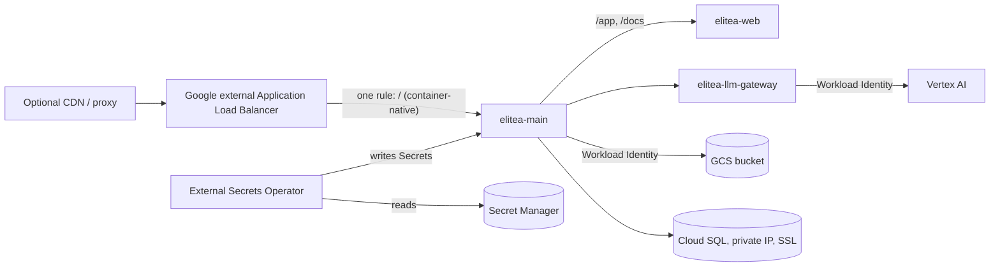

This page installs Elitea on Google Kubernetes Engine from **one Argo CD Application** that syncs **one chart**, `oci://ghcr.io/elitea-ng/charts/elitea`. The chart carries everything that runs in the cluster: the platform, NATS JetStream and its stream bootstrap, the vector store (elitea-vector and the bundled Qdrant), DeepWiki, Inventory and the GKE edge objects. Each feature is on by default and is one switch (`<feature>.enabled: false` leaves it out). No static cloud credential exists anywhere: object storage and the model providers authenticate as Google service accounts, and every secret comes from Google Secret Manager.

It is the GitOps path through the same install as [Deploy from scratch](/deployment/from-scratch) and [Deploy on Google Cloud (GKE)](/deployment/gcp). Those pages explain each choice; this one lists what must exist, the commands that create it, and the order of the first sync. The examples it refers to are in [`deploy/argocd/examples/gke/`](https://github.com/elitea-ng/elitea-platform/tree/main/deploy/argocd/examples/gke), written to be copied into a GitOps repository your organisation owns.

<Info title="One chart covers everything">
NATS, its certificates and the bootstrap Job are part of the `elitea` release, and so is Qdrant (the upstream qdrant chart, StatefulSet `elitea-vectordb`); there are no separate `nats`, `nats-bootstrap` or Qdrant charts to install. The sandbox-runtime installer is a dependency of the same chart (`sandboxRuntime.enabled`), but GKE does not need it: a GKE Sandbox node pool ships the `gvisor` RuntimeClass. Leave it off. Coming from the three-Application layout? Follow "One chart: NATS bundled" in [`docs/UPGRADING.md`](https://github.com/elitea-ng/elitea-platform/blob/main/docs/UPGRADING.md) first.
</Info>



## Preconditions

The chart creates none of these. Each one fails the first sync, or a pod soon after it, when it is missing.

| Precondition | What it must be | Commands |
|---|---|---|
| GKE cluster | Dataplane V2, Workload Identity Federation, private nodes, Cloud NAT | [The cluster](#the-cluster) |
| cert-manager | installed, with the `elitea-internal-ca` and `elitea-runtime-ca` Issuers in the `elitea` namespace | [cert-manager](#cert-manager) |
| Cloud SQL | PostgreSQL 16+, private IP, "Allow only SSL connections", role and two databases created by hand | [Cloud SQL](#cloud-sql) |
| GCS bucket and service accounts | a dedicated bucket, the `elitea-main` service account with `roles/storage.admin` on that bucket only | [GCS and service accounts](#gcs-and-service-accounts) |
| DNS and TLS | a global static IP, a DNS record for it, a cert-manager issuer for the public certificate | [Edge](#edge-ip-dns-tls-and-an-optional-proxy) |
| External Secrets Operator | installed, with a `ClusterSecretStore` on Secret Manager | [Secrets](#external-secrets-operator) |
| Argo CD | installed, with the chart registry registered | [Argo CD](#argo-cd) |
| Capacity | about 4 vCPU and 10 GiB of requests for the release | [Budget](#resource-budget) |

The commands use these names. Change them consistently:

```bash
PROJECT_ID=<your project>
REGION=<region>              # for example europe-west1
NS=elitea
```

### The cluster

Create a GKE Standard or Autopilot cluster with **Dataplane V2** (`--enable-dataplane-v2`; it enforces the chart's NetworkPolicies, `ipBlock` included), **Workload Identity Federation** (`--workload-pool=$PROJECT_ID.svc.id.goog`) and **private nodes**. Give the private nodes egress through Cloud NAT, for `ghcr.io`, where the images are published, and for the model providers:

```bash
gcloud compute routers create elitea-nat-router --network <VPC> --region "$REGION"
gcloud compute routers nats create elitea-nat --router elitea-nat-router \
  --region "$REGION" --auto-allocate-nat-external-ips --nat-all-subnet-ip-ranges
```

[The cluster](/deployment/gcp#the-cluster) on the Google Cloud page has the node sizing and the NodeLocal DNSCache caveat.

### cert-manager

Install cert-manager cluster-wide. The NATS CA, every NATS identity, the LLM gateway's, DeepWiki's and Inventory's mTLS hops, elitea-vector, Qdrant's TLS and the providers' callback client certificates are cert-manager `Certificate`s; you mint none of them by hand. Then create the namespace and the two Issuers the values name, exactly as in [Deploy from scratch, Step 1](/deployment/from-scratch#step-1-namespace-and-certificate-authorities):

- `elitea-internal-ca`: self-signed by cert-manager; nothing leaves the cluster. It issues the gateway, DeepWiki and Inventory hops.
- `elitea-runtime-ca`: a CA Issuer backed by the Secret `elitea-runtime-ca`. It issues elitea-vector's pair, Qdrant's `elitea-qdrant-tls` and the `elitea-deepwiki-callback-client` / `elitea-inventory-callback-client` certificates. On this path that Secret comes from Secret Manager (below), so the Issuer turns Ready on the first sync.

The NATS CA is the chart's own (`elitea-nats-ca`, wave `-10`); you create nothing for it. A cert-manager **Cluster**Issuer for the public certificate (ACME, or the origin CA issuer of a proxy in front) is the third thing cert-manager needs; see [Edge](#edge-ip-dns-tls-and-an-optional-proxy).

### Cloud SQL

Create a **PostgreSQL 16 or newer** instance with a **private IP** on the cluster's VPC (private services access) and **"Allow only SSL connections"**:

```bash
gcloud sql instances create elitea-pg --database-version POSTGRES_16 \
  --region "$REGION" --network "projects/$PROJECT_ID/global/networks/<VPC>" \
  --no-assign-ip --ssl-mode ENCRYPTED_ONLY \
  --tier <tier> --database-flags max_connections=200
```

`max_connections=200` is what `values-gke.yaml` sizes for (`postgresql.maxConnections: 200`, three elitea-main replicas at about 50 connections each). Change both together.

Cloud SQL has no superuser, so prepare the role and both databases once by hand. The password is the `db-password` that the mint script in the first of the [steps](#steps) writes:

```bash
gcloud sql users create elitea_v2 --instance elitea-pg \
  --password "$(cat elitea-material/db-password)"
```

Then, connected as `postgres`:

```sql
GRANT elitea_v2 TO postgres;
CREATE DATABASE elitea_v2 OWNER elitea_v2;
CREATE DATABASE elitea_v2_agentstate OWNER elitea_v2;
```

`values-gke.yaml` keeps the chart's database-preparation hook off and says the databases exist (`dbInit.enabled: false`, `dbInit.externallyManaged: true`). Every DSN carries `?sslmode=require`: the connection is encrypted, and the server certificate is not verified. `verify-ca` and `verify-full` are not supported yet, because the chart mounts no server CA. There is no Cloud SQL Auth Proxy.

### GCS and service accounts

The bucket and the Google service account are yours to create; the chart never creates a GCS bucket (`objectInit` stays off):

```bash
gcloud storage buckets create "gs://$PROJECT_ID-elitea-artifacts" --location "$REGION" \
  --uniform-bucket-level-access --public-access-prevention

gcloud iam service-accounts create elitea-main

# Bucket-scoped, never project-wide.
gcloud storage buckets add-iam-policy-binding "gs://$PROJECT_ID-elitea-artifacts" \
  --member "serviceAccount:elitea-main@$PROJECT_ID.iam.gserviceaccount.com" \
  --role roles/storage.admin

# Only the elitea-main KSA may act as it.
gcloud iam service-accounts add-iam-policy-binding \
  "elitea-main@$PROJECT_ID.iam.gserviceaccount.com" \
  --role roles/iam.workloadIdentityUser \
  --member "serviceAccount:$PROJECT_ID.svc.id.goog[$NS/elitea-main]"
```

`roles/storage.objectAdmin` alone is not enough: elitea-main rewrites the bucket's lifecycle rule at every start (`storage.buckets.update`) and exits when it cannot, so it crash-loops. `roles/storage.admin` bound on the bucket covers it; so does `objectAdmin` plus a custom role with `storage.buckets.get` and `storage.buckets.update`.

**Optional: Vertex AI without a key.** The LLM gateway can call Vertex AI as its own service account for **platform** credentials (`llmGateway.workloadIdentity`, on in `values-gke.yaml`):

```bash
gcloud iam service-accounts create elitea-llm
gcloud projects add-iam-policy-binding "$PROJECT_ID" \
  --member "serviceAccount:elitea-llm@$PROJECT_ID.iam.gserviceaccount.com" \
  --role roles/aiplatform.user
gcloud iam service-accounts add-iam-policy-binding \
  "elitea-llm@$PROJECT_ID.iam.gserviceaccount.com" \
  --role roles/iam.workloadIdentityUser \
  --member "serviceAccount:$PROJECT_ID.svc.id.goog[$NS/elitea-llm-gateway]"
```

[Platform models with a service account](/deployment/gcp#platform-models-with-a-service-account) covers AI DIAL and the admin console side.

### Edge: IP, DNS, TLS and an optional proxy

The chart's GKE Ingress is **one `/` rule to elitea-main**. elitea-main serves the API, redirects `/` to `/app/`, relays `/app` and `/docs` to elitea-web, and serves the MCP endpoint (`/app/<project id>/mcp`) itself, so no path rule, regular expression or header filter is needed at the load balancer. elitea-main deletes client-supplied identity headers itself.

```bash
gcloud compute addresses create elitea-ip --global
gcloud compute addresses describe elitea-ip --global --format 'value(address)'
# Point your DNS record (elitea.example.com) at that address.
```

With `main.ingress.gke` on, the chart renders, next to the Ingress:

- a **BackendConfig**: `timeoutSec: 3600`, so a streamed answer is not cut at the load balancer's 30-second default; an HTTP health check on `/healthz` port 8080; connection draining; and an optional Cloud Armor `securityPolicy`;
- a **FrontendConfig**: HTTP to HTTPS redirect, and an optional `sslPolicy`;
- the `cloud.google.com/neg` annotation on the elitea-main Service, so Google's front ends reach the pods directly. There are no ingress pods, so `networkPolicies.main.ingressFrom` must admit Google's ranges `35.191.0.0/16` and `130.211.0.0/22`; `values-gke.yaml` does.

`main.ingress.certManager.clusterIssuer` annotates the Ingress, and cert-manager issues the `tls[].secretName` Secret that the load balancer serves. Server-sent event streams carry a comment after 25 seconds of silence, well inside an idle timeout of about 100 seconds at a proxy in front.

**Behind a CDN or proxy** (Cloudflare or similar): issue the origin certificate through that provider's cert-manager issuer (`main.ingress.certManager.issuerKind` and `issuerGroup` name an external issuer), and keep everyone else off the load balancer with a Cloud Armor policy that admits only the proxy's published ranges:

```bash
gcloud compute security-policies create elitea-proxy-only
gcloud compute security-policies rules create 1000 \
  --security-policy elitea-proxy-only \
  --src-ip-ranges "<proxy range>,<proxy range>" --action allow
gcloud compute security-policies rules update 2147483647 \
  --security-policy elitea-proxy-only --action deny-403
```

A rule takes a limited number of ranges, so split a long list across several rules. Then set `main.ingress.gke.backendConfig.securityPolicy: elitea-proxy-only`. Add the proxy's ranges to `ELITEA_TRUSTED_PROXY_CIDRS` only if elitea-main should take the client address from the proxy's forwarding header.

### External Secrets Operator

Install the External Secrets Operator (ESO) and give it a `ClusterSecretStore` on Secret Manager. The example store, [`bootstrap/cluster-secret-store.yaml`](https://github.com/elitea-ng/elitea-platform/blob/main/deploy/argocd/examples/gke/bootstrap/cluster-secret-store.yaml), has no `auth` block: ESO's controller authenticates as its own Kubernetes service account through Workload Identity. The file's header has the `gcloud` commands that create that service account, grant it `roles/secretmanager.secretAccessor` on the two secrets below only, and link it. Then:

```bash
kubectl apply -f bootstrap/cluster-secret-store.yaml
kubectl get clustersecretstore gcp-secret-manager    # READY True
```

With `externalSecrets.enabled`, the chart renders one `external-secrets.io/v1` ExternalSecret for **every Secret it consumes**, derived from the same values the workloads read, so the list cannot drift from the pods. They are `PreSync` hooks in wave `-30`, so the Secrets exist before the migration Jobs that read them. Plain Kubernetes Secrets (`existingSecret` and friends) still work, but are not recommended in production.

### Argo CD

Argo CD pulls the chart from `ghcr.io` as an OCI Helm chart. Register the registry once; the charts are public, so the entry carries no credential:

```bash
kubectl apply -f bootstrap/helm-repository.yaml
```

Argo CD renders the chart with the Helm 3 it bundles, and the chart supports that (Helm 3.8 or newer). The Argo CD project you deploy into must allow the `elitea` namespace as a destination. The OCI chart carries its dependencies (the upstream NATS and Qdrant charts included), so the project needs no other source repository; a git source would also need `https://nats-io.github.io/k8s/helm/charts/` and `https://qdrant.github.io/qdrant-helm` in `sourceRepos` (see [GitOps with Argo CD](/deployment/argocd#source-the-published-chart)).

### Resource budget

`values-gke.yaml` is sized for **4 vCPU and 10 GiB of requests** with every default on (DeepWiki and Inventory included), at steady state and at the peak of any one rollout. CI sums the rendered requests, adds the largest rollout surge, and fails a change that breaks either.

| State | CPU requests | Memory requests |
|---|---|---|
| Steady state | 3670m | 8704Mi |
| Peak during a rollout (the largest single surge) | 3920m | 9856Mi |

The worker is the largest pod (1.5 vCPU, 3 GiB). It does not surge: `values-gke.yaml` sets `worker.rollingUpdate` and `main.rollingUpdate` to `maxSurge: 0, maxUnavailable: 1`. The old pod stops before the new one starts. Commands wait in JetStream for the minute the new worker takes to start, and one of the two elitea-main replicas keeps serving. With a surging worker the peak would be 5.2 vCPU / 11.5 GiB. Hook Jobs run for seconds and are not counted. At elitea-main's autoscaler maximum of 3, the steady state is 4070m / 9472Mi; scaling out under load uses the cluster's headroom above the reservation. To win back 450m / 1.5 GiB, leave DeepWiki or Inventory off (`enabled: false`). Qdrant also needs a 50Gi PersistentVolumeClaim (`standard-rwo`).

## Steps

<Steps>
<Step title="Mint the material and put it into Secret Manager">
Run the mint script of [Deploy from scratch, Step 4](/deployment/from-scratch#step-4-mint-the-secrets) with `DB_HOST` set to the Cloud SQL private IP. It writes every generated value into `./elitea-material`, and both DSNs with `sslmode=require`.

A Secret Manager property is a JSON string, so two keys the script writes as raw bytes are rewritten as text of a length the platform accepts. Add the gateway's hop-detection secret, then build one JSON object whose property names are the Kubernetes Secret and the key joined by `/`, for example `elitea-main-sso/oidc-client-secret`:

```bash
cd elitea-material
openssl rand -base64 32 | tr -d '\n' > auth-attempt-key         # 44 bytes: 32 to 64 accepted
openssl rand -base64 24 | tr -d '\n' > worker-output-spool-key  # exactly 32 bytes
openssl rand -base64 32 | tr -d '\n=' > gateway-hop-secret
printf '%s' '<client secret from your IdP>' > oidc-client-secret

p() { jq -n --arg k "$1" --rawfile v "$2" '{($k): $v}'; }
{
  p elitea-llm-gateway-secrets/identity-secret         gateway-identity-secret
  p elitea-llm-gateway-secrets/secrets-master-key      secrets-master-key
  p elitea-llm-gateway-secrets/hop-secret              gateway-hop-secret
  p elitea-main-llm-gateway-secrets/gateway-identity-secret gateway-identity-secret
  p elitea-main-sso/application-secret-key             application-secret-key
  p elitea-main-sso/oidc-client-secret                 oidc-client-secret
  p elitea-main-auth-material/auth-attempt-key         auth-attempt-key
  p elitea-main-auth-material/auth-pat-signing-key     auth-pat-signing-key
  p elitea-main-auth-material/auth-form-users.json     auth-form-users.json
  p elitea-qdrant-api/api-key                          qdrant-api-key
  p elitea-deepwiki-secrets/identity-secret            deepwiki-identity-secret
  p elitea-inventory-secrets/identity-secret           inventory-identity-secret
  for f in runtime-ca.crt command-signing-key.pem command-signing-keyring.json \
           control-server.crt control-server.key output-server.crt \
           output-server.key content-server.crt content-server.key; do
    p "elitea-runtime-material/$f" "$f"
  done
  for f in runtime-ca.crt agent-worker-client.crt agent-worker-client.key \
           command-signing-keyring.json worker-output-spool-key \
           agent-checkpoint-connection; do
    p "elitea-worker-material/$f" "$f"
  done
  p elitea-runtime-ca/tls.crt runtime-ca.crt
  p elitea-runtime-ca/tls.key runtime-ca.key
} | jq -s add > elitea-platform.json

gcloud secrets create elitea-platform --data-file elitea-platform.json
gcloud secrets create elitea-database-url --data-file database-url
rm elitea-platform.json
```

That is the whole inventory for the install on this page, every default on: 29 properties in `elitea-platform`, and the platform DSN alone in `elitea-database-url`, so a password rotation touches one secret. The `elitea-runtime-ca` pair is listed by the example values as an `extra` Secret, because no pod reads it; the `elitea-runtime-ca` Issuer does. Turning on an optional component (the cloud executor, say) adds Secrets, and turning a default off (`deepwiki.enabled: false`) removes its own; render the chart with your values and read the ExternalSecrets for the exact property list:

```bash
helm template elitea oci://ghcr.io/elitea-ng/charts/elitea --version <version> \
  -f values-gke.yaml -f your-values.yaml | yq 'select(.kind == "ExternalSecret")'
```

A missing property holds back its **whole** Kubernetes Secret: ESO syncs all keys of an ExternalSecret or none. Keep `elitea-material` out of git and somewhere safe; losing `secrets-master-key` makes every stored credential unreadable.
</Step>
<Step title="Write the values">
Start from the chart's own `values-gke.yaml` and override only what is yours. The example Application, [`applications/elitea.yaml`](https://github.com/elitea-ng/elitea-platform/blob/main/deploy/argocd/examples/gke/applications/elitea.yaml), does exactly that: `valueFiles: [values-gke.yaml]` (the file ships inside the published chart) and a short `values` block with the store name, the hostnames, the Google service accounts, the bucket, the OIDC client and the gateway origins. Pin `targetRevision` to an exact chart version.

Read `values-gke.yaml` once in full: it states the Cloud SQL, GCS, Ingress, NetworkPolicy, NATS and Qdrant settings this page relies on. It lets DeepWiki and Inventory clone from `github.com` only; restate `deepwiki.env.ELITEA_DEEPWIKI_GIT_ALLOWLIST` and `inventory.env.ELITEA_INVENTORY_GIT_ALLOWLIST` for your git hosts (the chart copies each to elitea-main). For three Qdrant nodes, add the chart's `values-qdrant-ha.yaml`.

```bash
helm pull oci://ghcr.io/elitea-ng/charts/elitea --version <version> --untar
less elitea/values-gke.yaml
```

Render your values before git does it for you. Each refusal names the field:

```bash
helm template elitea ./elitea -n elitea -f elitea/values-gke.yaml \
  -f your-values.yaml > /dev/null && echo renders
```

For three NATS nodes, add the chart's `values-nats-ha.yaml` after `values-gke.yaml`; it raises the bootstrap's replica count with it.
</Step>
<Step title="Apply the root Application">
Copy `deploy/argocd/examples/gke/` into your GitOps repository, point `root.yaml` at it, and apply the root once:

```bash
kubectl apply -f root.yaml
```

It renders `applications/`, which holds one Application, `elitea`. `bootstrap/` is not rendered by the root: you applied it by hand above.
</Step>
<Step title="The first sync">
Everything happens inside the one `elitea` Application, in this order:

| Phase | What runs |
|---|---|
| `PreSync`, wave `-30` | the ExternalSecrets; Argo CD waits until each is Ready |
| `PreSync` | the platform and agent-state migrations; a failed migration stops the sync |
| `PreSync`, wave `10` | the workload-session Job (the worker's row in `elitea_runtime.workload_sessions`) |
| wave `-10` | the NATS server, its CA, server and client certificates, and the `elitea-nats-bootstrap` Job, a `Sync` hook that creates every stream and KV bucket |
| wave `-5` | elitea-vector and Qdrant (the bundled qdrant chart) with its TLS Certificate |
| wave `0` | elitea-main, elitea-web, the scheduler, the LLM gateway, DeepWiki, Inventory, the OTel collector, the Ingress, BackendConfig and FrontendConfig |
| wave `1` | the agent worker |

The Google load balancer takes several minutes to program after the Ingress appears, and the certificate is issued once DNS points at the static IP.

With the Helm CLI instead of Argo CD, the same chart installs with `helm install elitea oci://ghcr.io/elitea-ng/charts/elitea --version <version> -n elitea -f values-gke.yaml -f your-values.yaml`. Do not pass `--wait` on a **first** install: the bootstrap Job is a post-install hook, and the workloads wait for the streams it creates. Helm 4.3 or newer is recommended for the CLI; Helm 3.8 or newer also works.
</Step>
<Step title="Verify">
```bash
kubectl -n elitea get externalsecrets          # every one READY True
kubectl -n elitea get certificates             # every one READY True
kubectl -n elitea rollout status statefulset/elitea-nats
argocd app get elitea                          # Synced, Healthy; hooks Succeeded
curl -si https://elitea.example.com/healthz | grep -i -e '^HTTP' -e '^vary'
# HTTP/2 200 and "vary: Origin": elitea-main answered, not the load balancer.
curl -si https://elitea.example.com/ | grep -i '^location'    # /app/
curl -s https://elitea.example.com/app/ | head -c 200        # the web app's HTML
```

Argo CD deletes the bootstrap Job when it succeeds, so `argocd app get` is where its result shows; a Job still in the namespace is one that failed, and its log names the stream or account. Then sign in, add a model provider and send a chat message, as in [Deploy from scratch, Step 8](/deployment/from-scratch#step-8-first-sign-in-the-public-project-and-models).
</Step>
</Steps>

## Troubleshooting

| Symptom | Likely cause | Fix |
|---|---|---|
| The Ingress has no address, or the backend is `UNHEALTHY` | the load balancer's health checks are refused by the NetworkPolicy | `networkPolicies.main.ingressFrom` must hold `35.191.0.0/16` and `130.211.0.0/22` |
| Streams stop with a 502 after about 30 seconds | the BackendConfig is not attached, so the backend keeps the 30-second default | check `main.ingress.gke.enabled` (or `className: gce`), the `cloud.google.com/backend-config` annotation on the Service and `timeoutSec: 3600` |
| Every request returns 403 from Google | the Cloud Armor policy does not admit the caller | add the proxy's current ranges, or clear `securityPolicy` while you test |
| The sync waits on an ExternalSecret that never turns Ready | the store, or ESO's identity, cannot read the secret, or a property is missing | `kubectl -n elitea describe externalsecret <name>`; check the store's READY, ESO's `roles/secretmanager.secretAccessor` and its Workload Identity link; compare the properties with the render |
| elitea-main CrashLoopBackOff right after a green sync, naming the bucket | the service account cannot update the bucket's lifecycle rule | grant `roles/storage.admin` on the bucket (not only `objectAdmin`) |
| elitea-main reads the bucket as the node's identity, or is refused | the `iam.gke.io/gcp-service-account` annotation or the `workloadIdentityUser` binding is missing | set both for `$NS/elitea-main` |
| Migrations fail with an SSL or `pg_hba` error | the DSN has no `sslmode`, or `verify-ca` / `verify-full` | use `sslmode=require` in both DSNs |
| Migrations fail with `permission denied to create database` or a missing database | the databases were not prepared by hand | run the three SQL statements of [Cloud SQL](#cloud-sql) |
| `FATAL: sorry, too many clients already` | `postgresql.maxConnections` is above the instance's flag | set both to the same number; lower `main.autoscaling.maxReplicas` |
| The bootstrap Job or the NATS pod stays Pending on a Secret | cert-manager has not issued the NATS certificates | `kubectl -n elitea get certificates,certificaterequests`; cert-manager must be running before the sync |
| elitea-vector waits for its certificate | the `elitea-runtime-ca` Issuer is not Ready | its Secret comes from the `elitea-runtime-ca` ExternalSecret; check that one first |
| The public certificate is never issued | DNS does not point at the static IP yet, or the issuer named in `certManager` does not exist | `kubectl -n elitea describe certificate elitea-tls` |
| elitea-main exits naming NATS or the presence bucket | the bootstrap Job has not succeeded | `argocd app get elitea`, then the Job's log |
| Vertex AI calls fail with a permission error | the gateway's service account lacks `roles/aiplatform.user`, or `llmGateway.workloadIdentity` is off | grant the role; keep the annotation and the switch |

[Deploy from scratch](/deployment/from-scratch#when-it-does-not-work) has the symptoms that are not specific to Google Cloud. [GitOps with ArgoCD](/deployment/argocd) covers promotion and rollback.

{/* source: deploy/argocd/examples/gke/ (root.yaml, applications/elitea.yaml, bootstrap/); deploy/helm/elitea/values-gke.yaml (preconditions, budget, externalSecrets, postgresql, dbInit, objectInit, networkPolicies.main.ingressFrom, main.ingress.gke, llmGateway.workloadIdentity, sandboxRuntime); deploy/helm/elitea/values.yaml (externalSecrets modes and ordering, main.ingress certManager and gke, sandboxRuntime); deploy/helm/tests/render-external-secrets.sh, render-gke-ingress.sh, render-gke-budget.sh; deploy/helm/elitea/templates/externalSecrets/; services/elitea-main/pkg/ssewriter/keepalive.go (25-second keepalive); services/elitea-main/internal/authcomposition/config.go (attempt key 32 to 64 bytes); services/elitea-worker-rust/src/spool.rs (32-byte spool key); docs/UPGRADING.md (one chart, one edge route, GKE Ingress, Helm 4). The property list is the render of values-gke.yaml plus the example values. Google Cloud commands are product behaviour, not tested by this repository. */}
